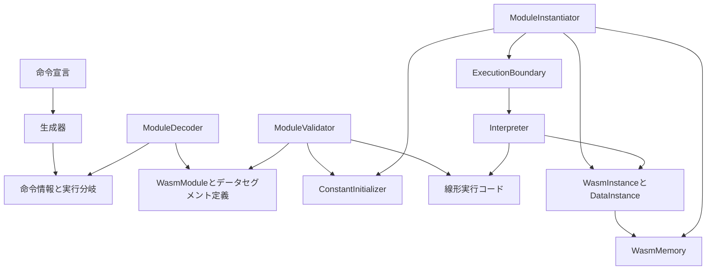
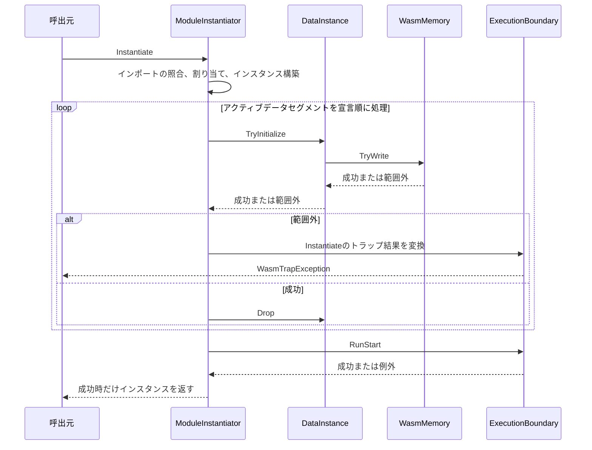

# 設計文書

## 概要

既存の公開APIが提供するDecode・Validate・Instantiate・Invokeの4段階で、Core 2.0のスカラーメモリ命令とデータセグメントによる初期化に対応する。
Wasm命令とホスト側の操作には、同じWasmMemoryを使用する。
利用者は既存APIで、メモリの状態、戻り値、失敗した処理段階を確認できる。

本書でいうメモリの共有とは、ホストと複数のインスタンスが同じWasmMemoryを参照することである。
スレッド間で共有するメモリ（shared memory/threads）は対象外とする。
メモリの生成、範囲を指定したアクセス、インポート時の照合に関する既存の公開契約を維持する。

### 目標

- [要件](requirements.md)にある54項目の受入基準を、DecodeからInvokeまで一貫して満たす。
- バイト領域の操作、命令の意味論、データセグメントの寿命、初期化の順序を別々の責務として扱い、同じ規則を重複実装しない。
- 固定したCore 2.0仕様本文と公式ケースの対応を記録し、既にpassedとなっているケースの回帰を防ぐ。

### 非目標

memory64・multi-memory・threads・SIMD・テーブル・要素セグメント・WASIへの対応、メモリを操作する公開APIの追加、記憶方式の変更、性能目標の設定は行わない。
汎用ストアや将来のためのプロバイダー、アロケーターを差し替える仕組みは新設しない。

## 責務境界（Boundary Commitments）

### 本仕様が担当する処理（This Spec Owns）

- メモリ命令、データセクション、データ数セクションの構文、静的検証、線形化、実行を扱い、バイナリ内の元の位置を保持する。
- 範囲を指定した読み書き、コピー、指定値でメモリ領域を埋める処理をWasmMemory内部にまとめる。
  挙動を追加する前に、公開契約を保ったまま責務を整理する。
- モジュールが所有する不変のデータセグメント定義と、インスタンスごとの破棄状態を扱う。
  アクティブデータセグメントによる初期化から開始関数の実行までを担当する。
  アクティブとパッシブの定義は[要件](requirements.md#対象範囲と隣接仕様)に従う。
- メモリの範囲外アクセスによるトラップの原因・位置・診断を扱い、本仕様に対応する公式ケースの受入を確認する。

### 対象外（Out of Boundary）

- host-linkingが担当する、メモリ型・サイズ制限・生成・共有・インポート時の照合の再設計と、公開APIのRead・Write・TryGrowの互換性変更は扱わない。
- tables-referencesが担当する、要素セグメントによる初期化、テーブル命令、参照命令は扱わない。
  tables-referencesを導入していない現在の構成では、要素セクション（ID9）はセグメント数が0の場合も引き続き未対応とする。
- simdが担当する、ベクトル値の変換とアクセス幅の定義は扱わない。
  共通のメモリ操作をベクトル型に依存させない。
- ランナーのJSON解釈・期待値・結果分類・検証プロファイル・公式テスト素材は変更しない。
  今回の仕様作成では、ランタイム本体・テスト・実行結果baselineを変更しない。

### 許容する依存（Allowed Dependencies）

- DecodeとValidateは静的な命令宣言とモジュール定義を参照し、メモリの内容やインスタンスの実行状態には依存しない。
- InterpreterとModuleInstantiatorはWasmMemoryおよびDataInstanceの操作を使用する。
  WasmMemoryは命令・関数・ランナーを参照しない。
- 定数式の検証・評価はModulesのConstantInitializerにまとめ、グローバル変数の初期化式とデータセグメントのオフセット式で使用する。
  評価処理は検証済みの式だけを受け取る。
- ExecutionBoundaryだけがExecutionResultのトラップを公開例外へ変換する。
  生成器はビルド時依存に留める。

### 再検証が必要な変更（Revalidation Triggers）

- 定数式の共通処理を抽出するとき、命令のメタデータを変更するとき、ExecutionResultの位置情報を変更するときは、host-linking・numeric-control・生成器を再確認する。
- 初期化処理に要素セグメントを追加するときは、要素セグメント、データセグメント、開始関数の順に処理することと、失敗前の副作用をtables-referencesと統合して確認する。
- SIMDのメモリ命令ハンドラーを追加するときは、実際のアクセス幅、範囲検査、共有するメモリの状態を再確認する。
- 固定した公式テスト素材・WABT・実行結果baselineを識別する条件が変わる場合は、本仕様の実装進捗と切り離し、既存の上流工程の手順で扱う。

## アーキテクチャ

### 既存構成と先行する責務整理

WasmMemoryは64KiBごとのbyte配列で4GiBまでのアドレス空間を表現する。
公開APIのRead・Writeは対象となる全範囲を先に確認し、TryGrowは必要な割り当てがすべて成功してからページ表を置き換える。
この構成を維持する。

挙動を追加する前に、公開APIのRead・Writeの範囲検査とページ内のバイトを転送する処理を、内部TryRead・TryWriteへ集約する。
グローバル変数専用だった定数式の検証・評価をConstantInitializerへ移す。
グローバル変数については既存の診断を選ぶ規則とsection=6を保ち、データセグメントのオフセット式に適用するときだけ、期待する型としてi32を、セクション識別子としてsection=11を指定する。

命令宣言は現在、メモリ命令の番号と名前だけを登録している。
既存の生成方式を拡張し、別のオペコード辞書や手書きの実行分岐を設けない。
ModuleBinaryFormatには、データ数セクション、コードセクション、データセクションの順に並ぶ規則が既に定義されているため、その規則を作り直さない。

### 構成と依存方向



矢印は処理上の参照・生成を表す。
静的定義と検証済みの実行コードはモジュール、データセグメントの可変状態はインスタンス、ページとメモリのサイズはWasmMemoryが所有する。
Interpreterは、現在実行している定義関数が所属するインスタンスを使う。

### 技術

| 対象 | 選択 | 用途 |
| --- | --- | --- |
| ランタイム | 既存のC# / .NET 10 | Span、ImmutableArray、BinaryPrimitivesによるバイト処理 |
| 命令生成 | 既存のnetstandard2.0生成器 | 属性から命令記述子とswitchによる実行分岐を生成 |
| テスト | 既存のTUnit | 公開APIを通る処理、必要な内部境界、生成器の動作を確認 |
| 公式受入 | 既存のTestSuiteRunnerと固定したCore 2.0の公式テスト素材 | runによる全テストの実行、compare-runによる比較、baseline-saveによる保存 |

追加パッケージや外部ランタイムは不要とする。
OS固有のメモリ操作やunsafeを導入せず、BCLのリトルエンディアン変換とSpan操作を利用する。

## ファイル構成計画（File Structure Plan）

パスはリポジトリルートを基準とする。
「変更」は既存ファイル、「追加」は新規ファイルを示す。
テストファイル名にテーマを付ける場合も、クラス名は対象メソッドに対応する既存のpartialクラスに合わせる。

| 区分 | パス | 責務 |
| --- | --- | --- |
| 変更 | src/WasmSharp/WasmMemory.cs | 範囲判定、公開操作を支える内部の読み書き、コピー、指定した値でメモリ領域を埋める処理 |
| 追加 | src/WasmSharp/Modules/ConstantInitializer.cs | 定数式の検証・検証済み式の評価 |
| 追加 | src/WasmSharp/Instructions/MemoryArgument.cs | アラインメントの指数とu32型のオフセット |
| 追加 | src/WasmSharp/Instructions/MemoryAccessSignature.cs | ロード命令・ストア命令の値型、アクセス幅、符号拡張の指定 |
| 変更 | src/WasmSharp/Instructions/InstructionAttribute.cs、ImmediateKind.cs、StackEffectKind.cs、ValidationRule.cs、InstructionSet.cs | 命令の構文、スタックから受け取る値と返す値の型、ハンドラー、メモリアクセス情報 |
| 変更 | src/WasmSharp.Generators/InstructionGenerator.cs、AnalyzerReleases.Unshipped.md | メタデータの生成と不正な宣言の診断 |
| 変更 | src/WasmSharp/Modules/DecodedInstruction.cs、src/WasmSharp/Execution/Instruction.cs | 型で表現したメモリ命令の即値と、実行時に使うアクセス情報 |
| 追加 | src/WasmSharp/Modules/Definitions/DataDefinition.cs | 不変のデータセグメント定義、アクティブデータセグメントの初期化先、データ数セクションの位置情報 |
| 変更 | src/WasmSharp/WasmModule.cs、Modules/ModuleDecoder.cs、Modules/ExpressionDecoder.cs | データセグメントの保持、セクションと即値の構文解析、データ数セクションの整合性確認、InstantiateのXMLドキュメントへの初期化中のトラップの追記 |
| 変更 | src/WasmSharp/Modules/ModuleValidator.cs、Modules/FunctionValidator.cs | 定数式・データセグメントへの参照・メモリ命令の検証と線形化 |
| 追加 | src/WasmSharp/Execution/DataInstance.cs | インスタンスごとのデータセグメントの内容への参照とDrop、指定範囲のメモリへの転送 |
| 変更 | src/WasmSharp/WasmInstance.cs、Modules/ModuleInstantiator.cs | データセグメントの実体の所有、アクティブデータセグメントによる初期化と開始関数の実行の接続 |
| 追加 | src/WasmSharp/Execution/Interpreter.Memory.cs | メモリ命令ハンドラーとmemory.grow失敗時の戻り値 |
| 変更 | src/WasmSharp/Execution/ExecutionResult.cs、Execution/ExecutionBoundary.cs | 初期化中に発生したトラップの位置情報と、公開例外への共通変換 |
| 変更 | tests/WasmSharp.Generators.Tests/WasmSharp.Generators.Tests.csproj、GeneratorTestSource.cs、InstructionGenerator_InitializeTests.cs | 追加する契約ソースの埋め込み、テスト用データ、生成結果のコンパイル |
| 追加・変更 | tests/WasmSharp.Tests/WasmMemory_ReadTests.cs、WasmMemory_WriteTests.cs、WasmMemory_TryGrowTests.cs、WasmMemory_TryCopyTests.cs、WasmMemory_TryFillTests.cs | ページ・範囲操作の契約 |
| 追加 | tests/WasmSharp.Tests/Modules/ConstantInitializer_ValidateTests.cs、ConstantInitializer_EvaluateTests.cs | グローバル変数とデータセグメントから抽出した共通規則 |
| 追加・変更 | tests/WasmSharp.Tests/Modules/ModuleDecoder_DecodeMemoryTests.cs、ModuleDecoder_DecodeFailureTests.cs、ModuleDecoder_DecodeInstructionTests.cs、ExpressionDecoder_ReadTests.cs、ModuleValidator_ValidateDataTests.cs、FunctionValidator_ValidateMemoryTests.cs | 構文と型検証 |
| 追加 | tests/WasmSharp.Tests/Execution/DataInstance_TryInitializeTests.cs、DataInstance_DropTests.cs | データセグメントの寿命と、転送前の全範囲検査 |
| 追加・変更 | tests/WasmSharp.Tests/Execution/Interpreter_LoadTests.cs、Interpreter_StoreTests.cs、ExecutionBoundary_ThrowIfFailedTests.cs | ハンドラーごとの境界値・ビット列の処理と、関数外で発生したトラップの変換 |
| 追加 | tests/WasmSharp.Tests/WasmModule_DecodeMemoryTests.cs、WasmModule_ValidateMemoryTests.cs、WasmModule_InstantiateDataTests.cs、WasmFunction_InvokeMemoryTests.cs | Decode・Validate・Instantiate・Invokeの4段階での動作、失敗、共有状態 |
| 変更 | tests/WasmSharp.Tests/WasmModule_DecodeTests.cs、WasmModule_DecodeStartTests.cs、WasmModule_InspectImportsTests.cs、Instructions/InstructionSet_TryGetTests.cs | 今回対応する機能を未対応と期待していたケースの更新 |
| 使用・必要時変更 | tests/WasmSharp.Tests/Fixtures/配下の既存バイナリテストデータ | データセグメントや予約バイトなどを明示したバイナリ入力。WATパーサーは追加しない。 |
| 出力 | artifacts/linear-memory/配下に毎回作成する新しいディレクトリ | ビルド・テスト・公式テスト全体の実行・比較の結果。既存結果を上書きしない。 |
| 実装時に追加 | .kiro/specs/linear-memory/acceptance.md | 全54項目と確認方法の対応、残る未対応の原因、検証結果と次の実行結果baselineの所在。仕様文書のレビュー時点では作成しない。 |

ModuleBinaryReaderの既存ReadU32と、読み取り範囲を制限したリーダーを使う。
新しい低水準のリーダーを設けない。
WasmTrapReason.MemoryOutOfBoundsは既存の値を利用する。

## 処理の流れ（System Flows）



ModuleInstantiatorは、範囲外アクセスで初期化に失敗した時点で処理を終了し、後続のデータセグメントや開始関数を処理しない。
先に初期化したデータセグメントの書き込みは残すため、全セグメントの範囲を一括で事前検査する方式は採らない。
リンクに失敗した場合は、共有するメモリを変更しない。

要素セグメントによる初期化は、tables-referencesでデータセグメントの処理より前に追加する。
本仕様では、そのためだけの空の拡張箇所は設けない。

## 要件対応（Requirements Traceability）

| 要件 | 内容 | 担当 | 契約・確認経路 |
| --- | --- | --- | --- |
| 1.1, 1.2 | 命令と即値 | InstructionDefinitions、MemoryDecoding | メモリ命令の即値と、値が0x00に固定された予約バイト |
| 1.3, 1.4, 1.5, 1.6, 1.7 | データセグメントの構文と所有 | MemoryDecoding | データセグメント定義、データ数セクション、Decode |
| 2.1, 2.2, 2.3, 2.4, 2.5, 2.6, 2.8 | 命令の検証 | MemoryValidation | スタックから受け取る値と返す値の型、インデックス、アラインメント、線形化 |
| 2.7 | オフセットを指定する定数式 | ConstantInitializer、MemoryValidation | i32型と、インポートした不変のグローバル変数 |
| 3.1, 3.2, 3.3, 3.4, 3.5, 3.6, 3.7 | スカラーアクセス | MemoryExecution、WasmMemory | Load・Store、TryRead・TryWrite |
| 4.1, 4.2, 4.3, 4.4, 4.5 | メモリサイズの取得と拡張 | MemoryExecution、WasmMemory | Size・Growと共有するメモリの状態 |
| 5.1, 5.2 | データセグメントの寿命 | DataInstance、DataInstantiation | インスタンスごとの状態 |
| 5.3, 5.4, 5.5, 5.6, 5.7, 5.8 | アクティブデータセグメントによる初期化 | DataInstantiation、DataInstance、ExecutionBoundary | 処理順序、失敗前の副作用、開始関数の実行 |
| 6.1, 6.2, 6.3 | memory.initとdata.drop | DataInstance、MemoryExecution | TryInitialize・Drop |
| 6.4, 6.5, 6.6, 6.7, 6.8 | メモリ内の範囲をまとめて操作する処理 | WasmMemory、MemoryExecution、DataInstance | TryCopy・TryFill・TryInitialize |
| 7.1, 7.4 | リソースの共有と定義関数が所属するインスタンス | MemoryExecution、DataInstantiation | 公開APIを使った統合テスト |
| 7.2, 7.3 | 失敗の分類と位置 | ExecutionBoundary、MemoryDecoding、MemoryValidation | 処理段階ごとの例外とmemory.growの戻り値 |
| 7.5 | 後続機能との責務境界 | MemoryDecoding、MemoryValidation、ConformanceAcceptance | 対象外の機能を引き続き未対応として扱うこと |
| 8.1, 8.2, 8.3, 8.4, 8.5, 8.6 | 公式テストによる受入 | ConformanceAcceptance | 全テストの実行、結果の比較、失敗原因の確認、結果の保存 |

## 構成要素と契約（Components and Interfaces）

表の担当名をタスクの`_Boundary:_`にも使う。
担当名は新しいクラスの追加を意味しない。

| 担当 | 役割 | 主要ファイル | 契約 |
| --- | --- | --- | --- |
| WasmMemory | バイト領域とページ操作 | WasmMemory.cs | Service・State |
| ConstantInitializer | 定数式の検証と評価 | Modules/ConstantInitializer.cs | Service |
| InstructionDefinitions | 命令の一元的な宣言・生成 | Instructions/、InstructionGenerator.cs | State |
| MemoryDecoding | データセグメントとメモリ命令の即値の構文 | ModuleDecoder.cs、ExpressionDecoder.cs、静的定義 | Service |
| MemoryValidation | 型検証と線形化 | ModuleValidator.cs、FunctionValidator.cs | Service |
| DataInstance | データセグメントの寿命と転送 | Execution/DataInstance.cs | Service・State |
| DataInstantiation | 初期化の順序 | ModuleInstantiator.cs、WasmInstance.cs | Service |
| MemoryExecution | ゲスト命令の意味論 | Interpreter.Memory.cs | Service |
| ExecutionBoundary | 失敗結果と公開例外 | ExecutionResult.cs、ExecutionBoundary.cs | Service |
| ConformanceAcceptance | 固定した公式テスト素材による実行結果の受入 | 既存ランナー、acceptance.md、artifacts/linear-memory/ | Batch |

### WasmMemory

**要件:** 3.6, 3.7, 4.2, 4.3, 4.4, 4.5, 6.4, 6.5, 6.6, 6.7, 6.8

**依存:** Inbound: MemoryExecution・DataInstance・ホスト（P0）。
Outbound: BCLのSpanのみ。

| 内部契約 | 結果 |
| --- | --- |
| bool ContainsRange(ulong offset, ulong length) | offset ≤ ByteLengthかつlength ≤ ByteLength-offsetを満たすかを返す |
| bool TryRead(ulong offset, Span<byte> destination) | 対象の全範囲が有効なら読み出したバイトをコピー先へ転送する。無効ならコピー先を変更せずfalseを返す |
| bool TryWrite(ulong offset, ReadOnlySpan<byte> source) | 対象の全範囲が有効ならコピー元のバイトをメモリへ転送する。無効ならメモリを変更せずfalseを返す |
| bool TryCopy(ulong destination, ulong source, ulong length) | コピー元とコピー先の全範囲を確認してから、範囲が重なっていてもコピー開始前のコピー元の内容がコピー先に書き込まれるように転送する |
| bool TryFill(ulong destination, byte value, ulong length) | 対象の全範囲を確認してから、valueで指定されたバイト値でメモリ領域を埋める |

ContainsRangeは内部操作とし、ページ配列も外部へ渡さない。
公開APIのRead・Writeは、内部操作がfalseを返した場合に既存のArgumentOutOfRangeExceptionを投げる。
内部操作は対象の全範囲を先に検査し、範囲外の場合はメモリやコピー先を変更しない。
処理するバイト数が0の場合も開始位置を検査する。

TryCopyとTryFillは、各ページ内の範囲をSpanで扱う。
処理する総バイト数をint型へ変換したり、対象全体を単一のSpanで表したりしない。
TryCopyは、コピー元とコピー先の重なり方に応じた方向でページをまたいで処理し、コピーするバイト数に比例する作業配列を確保しない。

まず読み書きを共通化し、既存テストで互換性を確かめてから、TryCopyとTryFillを追加する。

公開APIのTryGrowは変更しない。
ゲスト命令を実行するGrowハンドラーが、TryGrowの呼び出しで生じたOutOfMemoryExceptionだけを捕捉して、戻り値-1へ変換する。
メモリの初期割り当てやホストコールバックで発生した例外まで捕捉しない。

### ConstantInitializer

**要件:** 2.7, 5.3, 7.3

**依存:** Inbound: ModuleValidator・ModuleInstantiator（P0）。
Outbound: 静的な命令定義とグローバル変数の型・値（P0）。

- `Validate(ImmutableArray<DecodedInstruction> expression, WasmValueKind expectedKind, ReadOnlySpan<WasmGlobalType> importedGlobals, byte sectionId)`の戻り値の型はvoidとする。
  定数式で許可されない命令、グローバル変数のインデックス、可変性に関する違反を既存の優先順で診断し、結果の個数と型を検証する。
- `Evaluate(ImmutableArray<DecodedInstruction> expression, ReadOnlySpan<WasmGlobal> globals)`はWasmValueを返す。
  検証済みの式を受け取り、単一の定数命令またはglobal.getと、それに続くendで構成されていることを前提とする。
- 評価時には汎用のInterpreterを呼ばず、定数式で許可されない数値命令・制御命令を暗黙に有効化しない。
- グローバル変数では、既存のすべての値型と診断を維持する。
  データセグメントのオフセット式にはi32型だけを要求する。
  位置情報のセクションIDには、グローバル変数の初期化式では6を、データセグメントのオフセット式では11を保持する。

### InstructionDefinitions

**要件:** 1.1, 1.2, 2.2, 2.3, 2.4, 3.2, 3.3, 3.4, 3.5

**依存:** Inbound: Decode・Validate・実行分岐（P0）。
Outbound: 命令属性を処理する生成器（ビルド時P0）。

- MemoryArgumentは`uint Alignment, uint Offset`を保持する。
  DecodedInstructionに専用のファクトリーメソッドと項目を追加し、制御命令用のLabelsやTargetCountを流用しない。
- MemoryAccessSignatureは`WasmValueKind ValueType, byte ByteWidth, bool SignExtend`を保持する。
  ロード命令・ストア命令のValidationRuleと組み合わせ、値型と実際のアクセス幅をInstructionSetで一度だけ宣言する。
- 生成器は、属性のメモリ用オーバーロードと数値用オーバーロードを引数の型で区別し、引数の個数だけでは分類しない。
  この情報を命令記述子へ出力する。
  Validate後のInstructionにメモリ命令の即値とMemoryAccessSignatureを保持し、共通のLoad・Storeハンドラーへ渡す。
  ハンドラー内に、オペコード番号から型と幅を復元するための別表を置かない。
- ImmediateKindはMemoryArgument、MemoryZero、MemoryPairZero、DataIndexMemoryZero、DataIndexを区別する。
  DataIndexMemoryZeroのmemory.initとDataIndexのdata.dropの両方を、コードセクション内のデータセグメント参照として扱い、データ数セクションの要否判定に使う。
- ValidationRuleはMemoryLoad、MemoryStore、MemorySize、MemoryGrow、MemoryBulk、MemoryInit、DataDropを区別する。
  MemoryBulkが受け取る3つの値は、すべてi32型とする。
  ストア命令はアドレスと書き込む値の型が異なる場合があり、結果も返さないため、既存のNumericSignatureを流用しない。
- StackEffectKindにはMemoryLoad、MemoryStore、MemoryGrow、MemoryBulkを追加する。
  memory.sizeは既存のPushI32、memory.init・memory.copy・memory.fillはMemoryBulk、data.dropは既存のNoneを使う。
  ロード命令・ストア命令の値型はMemoryAccessSignatureから取得し、数値用メタデータへ重複して記録しない。
- 生成器で、値型と幅の不整合、ストア命令や浮動小数点命令への符号拡張の指定、メタデータの不足を診断する。
  既存のハンドラーシグネチャ`ExecutionResult Handler(InterpreterContext context, in Instruction instruction)`と、ハンドラーを直接呼び出すswitchを維持する。
- 共通契約を追加する段階では未対応を示す既存の命令宣言を維持し、対象命令のDecode・Validate・ハンドラーが揃う統合タスクで対応済みの宣言へ切り替える。
  成功を装う仮のハンドラーは置かない。
- 新しいMemoryArgument・MemoryAccessSignatureを生成器テストに埋め込む契約ソースに含め、これらの型への参照が必要になるテスト用データも更新する。
  生成したコードは手編集しない。

### MemoryDecodingとMemoryValidation

**要件:** 1.1, 1.2, 1.3, 1.4, 1.5, 1.6, 1.7, 2.1, 2.2, 2.3, 2.4, 2.5, 2.6, 2.7, 2.8, 7.3, 7.5

**依存:** Inbound: WasmModuleの公開操作（P0）。
Outbound: 命令情報、ConstantInitializer、静的定義（P0）。

Decodeは構文だけを扱い、アラインメントの意味上の上限や、指定されたインデックスのメモリが存在するかは調べない。
値が0x00に固定された予約バイトはReadByteで読み取り、その1バイトが0x00であることを要求する。
複数バイトのLEB128で表した0は代わりに使用できない。
データセグメントのフラグと、明示されたメモリインデックスはu32として読む。

対応する全セクションの構文と長さを検査した後、function/codeの個数、データ数セクションとデータセグメント総数の一致、データ数セクションの要否の順で確認する。
データセクションが未対応の間は、既存のdata先頭でのfunction/codeの早期照合を維持する。
5.2でデータセクションに対応するときに、この早期照合を外して読了後の照合へ集約し、データセクションの構文違反を先に報告する。
ただし、データ部の未対応命令により読了できない場合は、その時点で確定済みのfunction/codeの個数不一致、データ数不一致、必要なデータ数セクションの欠落をこの順で確認し、該当する違反を未対応より優先してDecode失敗として報告する。
ここでは、読み取った宣言件数と対応済み命令の情報だけを使い、未対応命令の後ろを走査する処理は追加しない。
確定済みの違反がなければ、既存どおり未対応を報告し、入力全体の有効性は保証しない。
コード内のmemory.initとdata.dropは、どちらもデータ数セクションを要求する。
この使用の有無は、関数本体の対応済み命令から判定し、到達不能な部分も確認対象に含める。
データ数セクションが存在し、データセクションが存在しない場合は、指定されたデータ数が0のときだけ整合すると判断する。
セクションの順序と長さの制限には、既存の規則を使用する。

FunctionValidatorは、命令に必要な参照とアラインメントを、型スタックの検査より先に検証する。
ロード命令・ストア命令はメモリの存在、アラインメントの順とし、memory.initはメモリの存在、データセグメントのインデックスの順とする。
data.dropはデータセグメントのインデックスだけを先に検証する。
自然なアラインメント（その命令が読み書きするバイト数）を上限とし、その値をByteWidthから求める。
検査のために任意のu32値を指数とするシフトは行わない。
ロード命令はi32型の値をスタックから取り出し、ValueTypeの値を積む。
ストア命令はValueTypeの値を取り出し、続いてi32型の値を取り出す。
memory.init・memory.copy・memory.fillのオペランドは、コピー先、コピー元または書き込む値、処理するバイト数の順に並ぶ。
data.dropはメモリの存在を要求しない。

ModuleValidatorは、ValidateResourcesの後、ValidateFunctionsの前にデータセグメントを宣言順で検証する。
アクティブデータセグメントでは、初期化するメモリを確認し、ConstantInitializerへ期待する型としてi32を渡す。
パッシブデータセグメントは、メモリがなくても有効とする。
データセグメントの初期値を書き込む範囲が有効かどうかは、Instantiate時点の共有するメモリのサイズに依存するため、Validateでは判定しない。
検証済みの実行コードは、既存どおりモジュール全体の検証が成功したときだけ公開する。

データセクションへの対応を準備している間は、Decodeで未対応と判定する既存の動作を維持する。
データセグメントの定義・検証・初期化が揃う統合タスクで、これらの処理を接続する。
実装途中のInstantiateが、アクティブデータセグメントを無視して成功する状態を作らない。

InspectImportsの調査範囲は拡張しない。
既存テストでは、通常のDecodeが未対応として失敗するという期待を更新する。
InspectImportsのテスト内にもDecodeの結果を比較する箇所があるため、その期待値は更新対象とするが、InspectImportsが残す未確認範囲は維持する。

### DataInstanceとDataInstantiation

**要件:** 5.1, 5.2, 5.3, 5.4, 5.5, 5.6, 5.7, 5.8, 6.1, 6.2, 6.3, 6.7, 6.8, 7.1, 7.2, 7.4

**依存:** Inbound: ModuleInstantiator・MemoryExecution（P0）。
Outbound: WasmMemory、ConstantInitializer、ExecutionBoundary（P0）。

DataInstanceは不変の初期バイト列への参照を持ち、Dropでその参照を空のバイト列への参照に置き換える。
モジュールの定義は変更せず、同じモジュールから生成したインスタンス間で破棄状態を共有しない。
初期化直後のアクティブデータセグメントもパッシブデータセグメントも、データインデックス空間に残る。

| 契約 | 前提・結果 |
| --- | --- |
| uint Length | データセグメントが現在保持しているバイト数。Drop後は0となる |
| bool TryInitialize(WasmMemory memory, uint destination, uint source, uint length) | コピー元の範囲を、より広い整数型で確認し、指定されたメモリへTryWriteで書き込む。コピー元かコピー先のいずれかが範囲外なら、何も変更せずfalseを返す |
| void Drop() | データセグメントの内容への参照を、空のバイト列への参照に変更する。繰り返し呼び出しても成功する |

コピー元の範囲検査が成功してから、Spanを参照するためのint型のインデックスへ変換する。
初期バイト列として保持できるバイト数は既存のコレクション上限に従い、u32で表したバイト数を無条件にintへ変換しない。
TryInitializeではデータセグメントの内容を保持する。
データセグメントを保持するための別の可変byte配列は作らない。

ModuleInstantiatorは、リンク、リソースの割り当て、グローバル変数の初期化、関数を含むインスタンスの構築を完了してから、アクティブデータセグメントを宣言順に処理する。
オフセットには、ConstantInitializerで評価したi32のビット列を符号なし整数として解釈した値を使う。
TryInitializeが成功した場合だけDropを呼び出す。
失敗した場合は、そのデータセグメントの位置を持つトラップをExecutionBoundaryで公開例外へ変換して送出する。
すべてのアクティブデータセグメントの処理が完了した場合だけRunStartを呼び出す。

### MemoryExecutionとExecutionBoundary

**要件:** 3.1, 3.2, 3.3, 3.4, 3.5, 3.6, 3.7, 4.1, 4.2, 4.3, 4.4, 4.5, 6.1, 6.2, 6.3, 6.4, 6.5, 6.6, 6.7, 6.8, 7.1, 7.2, 7.3, 7.4

**依存:** Inbound: 生成されたswitchと公開APIの実行境界（P0）。
Outbound: 定義関数が所属するインスタンス、WasmMemory、DataInstance（P0）。

Load・Storeは最大8バイトの局所バッファとBinaryPrimitivesを使う。
実効アドレスは`(ulong)(uint)i32 + offset`で求め、その位置からアクセス幅分のバイトがメモリ内に収まるかを判断する。
浮動小数点値は、WasmValueが提供するビット列からの構築とビット列の取得を使って扱う。
数値変換を介してNaNを作り直さない。

Sizeは現在のページ数を返す。
Growは同じメモリを拡張し、成功時は拡張前のページ数、失敗時は-1を返す。
MemoryInit・Copy・Fillは、処理するバイト数、コピー元または書き込む値、コピー先の順でスタックから取り出し、符号なし整数として解釈する。
DataDropはスタックからオペランドを取り出さない。
WasmMemoryまたはDataInstanceの操作がfalseを返した場合は、MemoryOutOfBoundsを原因とするExecutionResultへ変換する。

ExecutionResult.TrapのfunctionIndexをnull許容にし、sectionIdを省略可能な引数として追加する。
関数内の既存の呼び出しは、同じ引数で動作する。
データセグメントによる初期化では、functionIndex=null、byteOffsetにはデータセグメントの先頭位置、sectionId=11を指定する。
ThrowIfFailedは、これらの情報と呼び出された処理段階からWasmFailureLocationを構成する。
MemoryOutOfBoundsの診断文の先頭は`out of bounds memory access`とする。

Invokeと開始関数の実行後のコンテキスト復元、ホスト例外をそのまま伝播する挙動、再エクスポートした定義関数が所属するインスタンスは変更しない。
メモリの範囲外アクセスをCLR例外で検出してからトラップへ変換する方式は採らない。

### ConformanceAcceptance

**要件:** 8.1, 8.2, 8.3, 8.4, 8.5, 8.6, 7.5

**依存:** Inbound: 実装の受入工程。
External: 固定した公式テスト素材と既存ランナー（P0）。

Batch契約では、runによる全テストの実行、保存済み結果に対するcompare-run、受入確認、同じ実行結果を使うbaseline-saveの順に処理する。
入力は現在のmanifestと、統合先に取り込まれた先行機能について最後に明示保存された実行結果baselineとする。
先行仕様の受入記録から比較元を特定し、同じ検証プロファイルと固定素材で比較できることを確認する。
結果JSON・比較JSON・実行記録は新しいディレクトリへ出力する。
異常がある場合は、実行結果baselineの保存へ進めない。

より新しい先行機能の受入結果が統合先に取り込まれていない場合、比較元の候補は`artifacts/numeric-control/task-11.4-20261012T-baseline-7ca484f/run-baseline.json`とする。
先行仕様の[受入記録](../numeric-control/acceptance.md)と照合し、実装着手時にファイルの存在、ハッシュ値、対応するmanifestを確認する。
記録されたSHA-256は`02ab113a70b5dd1c6ceb5aca12c901dddb8735b1754a035c999953baae9ad779`である。
tables-referencesなどを先に取り込んだ場合は、その受入記録にある比較元を選び、パス・SHA-256・保存元の仕様・対応するmanifestをacceptance.mdへ記録する。
実装途中に統合先を更新した場合も、最終比較の前に同じ手順で比較元を確認する。
日時だけで新しいファイルを選ばず、比較元の内容は本仕様の受入が完了するまで更新しない。
公式テスト素材や実行結果baselineがない場合は、独断で新しい条件へ置き換えない。

acceptance.mdには、54項目と公式ケース・直接テストの対応、残るruntime_unsupported・blockedの原因を記録する。
run・compare-run・baseline-saveのコマンド、終了コード、結果件数、出力パスとSHA-256を記録し、次の機能が参照するbaselineを明示する。
大容量の結果JSONはartifacts配下に保存し、後続仕様が必要とする情報をacceptance.mdに残す。

runの終了コードが0であるだけでは、本仕様の受入とはしない。
54項目すべての基準との対応、本仕様だけで成立する対象ケースがpassedであること、failed・runner_error・回帰がいずれも0件であることを確認する。
また、残る未対応ケースとblockedのケースについて、どの後続機能が原因であるかを確認する。
テーブルとSIMDへの依存が残るため、全体に対するverifyの終了コードが0であることは、本仕様単独の受入条件にしない。

## データモデル（Data Models）

| 所有者 | データ | 不変条件 |
| --- | --- | --- |
| WasmModule | ImmutableArray<DataDefinition>、省略可能なDataCountDefinition | 入力からコピーして保持し、Instantiate・Dropでは変更しない |
| DataDefinition | ImmutableArray<byte> Bytes、ActiveDataTarget? ActiveTarget、long ByteOffset | ActiveTarget=nullはパッシブデータセグメントを表す。アクティブデータセグメントでは、メモリインデックスとオフセットを求める命令列をActiveTargetにまとめる |
| DataCountDefinition | uint Count、long ByteOffset | セクションがないことと、存在して値が0であることを区別する。Decodeでデータセグメントの総数と照合する |
| WasmInstance | ImmutableArray<DataInstance> | インデックスの順序はモジュールの定義順とする。各要素の破棄状態は独立させる |
| Instruction | MemoryArgument、MemoryAccessSignature、データセグメントのインデックス | 検証済みの命令だけが、対応する項目を参照する |
| WasmMemory | 既存のpages_と上限 | メモリの同一性を保ち、ページ表を差し替える前に、拡張に必要な割り当てを完了する |

ActiveDataTargetとDataCountDefinitionはDataDefinition.csに同居させる。
永続化や、モジュール間でデータセグメントをエクスポートする機能は追加しない。
単一スレッドでの同期実行と再入という既存の保証範囲を維持する。

## エラー処理（Error Handling）

| 条件 | 処理段階・結果 | 変更 |
| --- | --- | --- |
| LEB128・予約バイト・フラグ・セクション・データ数セクションの不正 | Decode / WasmDecodeException | モジュールを返さない |
| メモリやデータセグメントのインデックス、型、アラインメント、オフセットを指定する定数式の違反 | Validate / WasmValidateException | 検証成功状態を確定しない |
| インポート時の照合不成立 | Instantiate / 既存のWasmInstantiateException | データセグメントによる初期化を始めない |
| アクティブデータセグメントの初期化先がメモリの範囲外 | Instantiate / WasmTrapException | 先行するデータセグメントによる変更を維持する |
| 関数からのメモリアクセスが範囲外 | InvokeまたはInstantiate / WasmTrapException | 失敗した命令による書き込みは行わない |
| ゲストのmemory.growが上限を超えるか、必要な割り当てに失敗 | i32の-1 | メモリのサイズと内容を維持する |
| ホストから呼び出したRead・Writeの範囲指定の誤用、ホストから呼び出したTryGrowでのメモリ割り当て失敗 | 既存のCLR例外契約 | ゲストのトラップへ置き換えない |
| データセグメントの保持に必要なコレクションが実装上限を超える | 該当段階 / WasmImplementationLimitException | 無理に配列を確保しない |
| 未対応の後続機能を使用 | 既存のWasmUnsupportedFeatureException | 原因と未確認範囲を保持する |

診断文の先頭は、固定した参照実装と公式テストが期待する診断に合わせる。
代表的な診断は`zero byte expected`、`data count section required`、`data count and data section have inconsistent lengths`、`unknown memory`、`unknown data segment`、`alignment must not be larger than natural`、`type mismatch`とする。
複数の違反がある場合の診断順序は、固定した公式ケースと参照実装から確認した規則を通常入力にも適用する。
変更する検査順序は必要な境界条件で確認し、任意の複合不正すべての完全互換までは求めない。
テストIDに応じた分岐は追加しない。

## 検証方針（Testing Strategy）

### 直接テスト

| 対象 | 観測内容 | 要件 |
| --- | --- | --- |
| 構文 | すべての即値形式、予約バイトが0x00でない場合と複数バイトのLEB128で0を表した場合、不正なLEB128とフラグ、データ数セクションの欠落・不一致・順序違反・省略、入力からのコピー | 1.1, 1.2, 1.3, 1.4, 1.5, 1.6, 1.7 |
| 静的検証 | 命令ごとの型、自然なアラインメント、メモリとデータセグメントのインデックス、到達不能な部分の違反、メモリがない場合のパッシブデータセグメントとdata.drop、定数式とグローバル変数に関する既存の診断 | 2.1, 2.2, 2.3, 2.4, 2.5, 2.6, 2.7, 2.8 |
| スカラーアクセス | 全23命令、リトルエンディアン、符号拡張とゼロ拡張、切り捨て、NaNのペイロード、非整列アクセス、ページ境界をまたぐアクセス、33ビットでの加算、ストア命令が失敗した場合にメモリを変更しないこと | 3.1, 3.2, 3.3, 3.4, 3.5, 3.6, 3.7 |
| memory.grow | 拡張前のサイズを返すこと、追加ページ数が0の場合、上限を超える場合、追加ページ数を符号なし整数として解釈すること、追加領域のゼロ初期化、失敗後にサイズと内容を変更しないこと | 4.1, 4.2, 4.3, 4.4, 4.5 |
| データセグメントとメモリの範囲操作 | インスタンスごとに独立した破棄状態、アクティブデータセグメントの自動破棄、memory.initがデータセグメントを消費しないこと、両方向に重なる範囲とページ境界をまたぐコピー、memory.fillが値の下位1バイトを使うこと、処理するバイト数が0の場合のコピー元・コピー先の境界、処理範囲のいずれかが無効な場合の失敗 | 5.1, 5.2, 6.1, 6.2, 6.3, 6.4, 6.5, 6.6, 6.7, 6.8 |
| 公開APIを使った統合 | アクティブデータセグメントの範囲が重なる場合の処理順序、インポートした不変のグローバル変数を使うオフセット式、先行するデータセグメントによる変更の保持、開始関数からの状態確認とトラップ後の参照、共有するメモリの拡張、再入、再エクスポートした定義関数が所属するインスタンスのデータセグメント、失敗位置 | 5.3, 5.4, 5.5, 5.6, 5.7, 5.8, 7.1, 7.2, 7.3, 7.4, 7.5 |

通常のテストでは、4GiBの確保や実際のメモリ割り当て失敗を強制しない。
上限を超えた場合の失敗と符号なし整数の境界値は、小さいメモリで再現する。
OutOfMemoryExceptionを戻り値へ変換する処理は、例外を捕捉する範囲とTryGrowが状態を確定する順序をコードレビューで確認する。
メモリ割り当て失敗を再現するためだけに、アロケーターを注入する仕組みは追加しない。

### 公式ケースと不足の補完

以下は代表例であり、対象ケースの全一覧ではない。
8.3では全体の実行結果から、bulk.wast・memory.wast・traps.wast・memory_redundancy.wast・imports.wast・custom.wastも含めて本仕様に関係するケースを洗い出し、受入基準へ対応付ける。

- `binary.wast`・`binary-leb128.wast`・`align.wast`・`data.wast`で構文・型・オフセットを確認する。
- `load.wast`・`store.wast`・`address.wast`・`endianness.wast`・`float_memory.wast`・`memory_trap.wast`でスカラーアクセスと範囲の境界を確認する。
- `memory_size.wast`・`memory_grow.wast`・`memory_copy.wast`・`memory_fill.wast`・`memory_init.wast`でメモリサイズの取得と拡張、範囲をまとめて操作する命令、データセグメントの破棄を確認する。
- `linking.wast`・`start.wast`のうち、テーブルやSIMDを必要とせずメモリだけを使うケースで、初期化と共有を確認する。
  テーブルやSIMDも必要とするケースは、未成立の原因を記録して後続仕様へ引き継ぐ。
- メモリがないモジュール内のパッシブデータセグメントに対するdata.dropと、到達不能な部分にある不正なアラインメントやデータセグメントのインデックスは、固定した仕様本文に基づく直接テストで補完する。
  これらを公式ケースで確認したとは記載しない。

### 実行順序とコマンド

テストを追加・変更した場合は、先にReleaseビルドの警告とエラーがいずれも0件であることを確認してから、対象テストを実行する。
まとまった機能の統合時と最終受入では、3つのテストプロジェクトと、固定した版の公式テストスイート全体を実行する。
検証コマンドは既存のREADMEに従う。

```powershell
dotnet build WasmSharp2.slnx -c Release --warnaserror --disable-build-servers
dotnet run --project tests/WasmSharp.Tests/WasmSharp.Tests.csproj -c Release --no-build
dotnet run --project tests/WasmSharp.Generators.Tests/WasmSharp.Generators.Tests.csproj -c Release --no-build
dotnet run --project tests/WasmSharp.TestSuiteRunner.Tests/WasmSharp.TestSuiteRunner.Tests.csproj -c Release --no-build
```

テストの絞り込みには`-- --treenode-filter "/*/*/対象クラス/*"`を使う。
公式テストのCLI操作には、[ランナーREADME](../../../tools/WasmSharp.TestSuiteRunner/README.md)に従って`run --manifest ... --output ...`、`compare-run --baseline ... --current ... --output ...`を使い、受入後に`baseline-save --input ... --output ...`を使う。
省略部は、着手時に確認した公式テスト素材と結果のパスで置き換える。
公式テストを実行するたびに実行結果baselineを更新することはしない。

## 設計確定前の確認

親エージェントは、要件54項目との対応、責務と変更ファイル、既存の公開契約、初期化失敗時の副作用、生成器のテスト用データの前提、公式テストによる受入条件を確認した。
これは仕様生成時の内部レビューであり、実装検証や独立した設計検証によるGO判定を意味しない。
調査で参照した具体的な箇所と比較検討は[research.md](research.md)に記録する。
