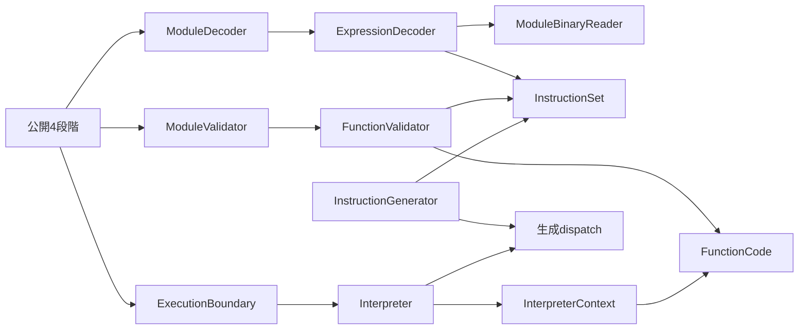
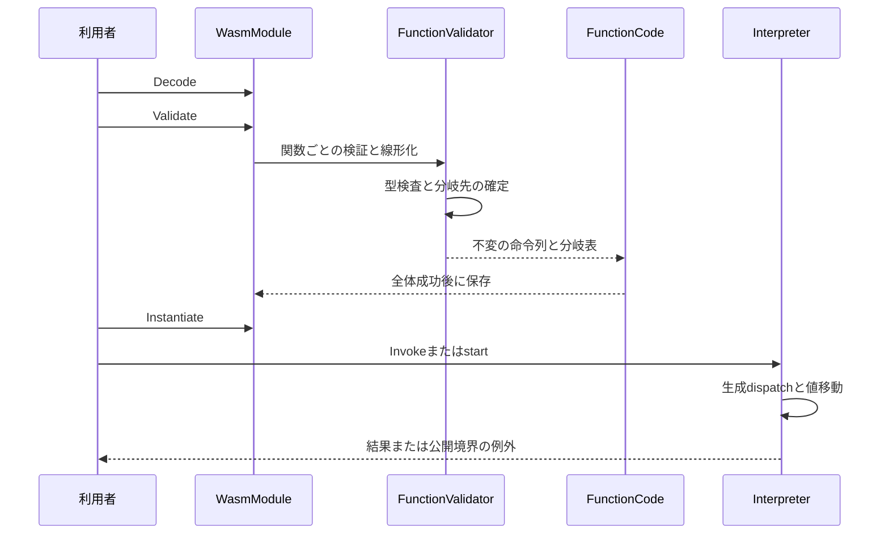

# numeric-control技術設計

## 概要（Overview）

スカラー数値演算と構造化制御を、既存のDecode・Validate・Instantiate・Invokeへ追加する。利用者は関数・ホスト連携・共有globalと組み合わせて計算し、型不成立、数値trap、exhaustionを既存の公開契約で区別できる。

既存ランタイムの拡張として、式読取りと関数内検証の責務を先に分離し、型検査と線形化を同一パスで行う。公開API、値表現、呼出し機構、公式ランナーは再利用する。設計の対象は[requirements.md](requirements.md)の73受入基準であり、調査結果は[research.md](research.md)へ記録する。

### 目標（Goals）

- 対象の整数・浮動小数点・変換・select・構造化制御を4段階で扱う。
- 全値型の制御による運搬、既存の関数・状態・失敗契約、参照診断互換性を維持する。
- 固定公式147入力の全体実行と直前baseline比較で対象機能の成立と回帰0を確認する。

### 非目標（Non-Goals）

- memory/table命令、segment初期化、call_indirect、参照固有命令、参照のtyped select、v128のselect、SIMD演算。
- 新しい公開API、実行エンジン、ランナー、WAT/WAST解析、extended-const、時間・命令数による中断保証。
- 性能の数値保証、追加TFM・OS対応、Core 2.0全体の完成宣言。

## 責務境界（Boundary Commitments）

### 本仕様が所有するもの（This Spec Owns）

- 対象命令の即値、入れ子式、局所的な型検証、分岐の線形化、数値と制御の実行意味論。
- moduleが所有する不変な分岐情報と、現在の関数内で値を保持・破棄して分岐する操作。
- 追加命令によって到達可能になる公開診断、先行機能との組合せ、仕様と受入証拠の対応。

### 所有しないもの（Out of Boundary）

- `WasmValue`、関数・リソースの同一性、import/export、ホスト登録、startの順序、同期再入・深さ制限の基本契約は先行仕様が所有する。
- `linear-memory`・`tables-references`・`simd`の固有命令と初期化は実装しない。制御がv128や参照を運ぶ能力と、それらへの演算を区別する。
- 公式JSONの解釈、spectest、値・診断の比較、結果分類、baseline保存・比較は既存ランナーが所有する。本仕様のための合格条件をランナーへ埋め込まない。

### 許可する依存（Allowed Dependencies）

- `runtime-foundation`・`host-linking`・`test-suite-conformance`のランタイム契約と、`test-suite-runner`の公開CLIを利用する。
- 依存方向は`ExpressionDecoder → ModuleBinaryReader・InstructionSet`、`FunctionValidator → DecodedInstruction・InstructionSet・FunctionCode`、`Interpreter → InterpreterContext・WasmValue・ExecutionResult`とする。矢印の左側が右側を利用する。実行側はFunctionValidator/ExpressionDecoderを参照しない。
- 既存のDecodedFunction/LocalDeclaration等へのExecutionからの参照は維持する。デコーダー・検証器・生成器の実装へ実行時依存を追加しない。
- 生成器はAnalyzerとしてビルド時だけ参照する。ランタイムからテスト、公式JSON、WABT、公式ケースIDへの依存を禁止する。

### 再検証の契機（Revalidation Triggers）

- 即値・NumericSignature・分岐表・handler契約の変更時は生成器、Decode、Validate、下流3仕様の命令接続を再確認する。
- OperandBase、値移動、CompleteFrame、実行コンテキストの変更時はhost-linkingの複数結果・再入・失敗復元を再確認する。
- 診断文・原因選択・Unsupportedの段階やFeatureの変更時はtest-suite-conformanceの否定assertionと残存未対応の所有先を再確認する。
- .NET/JIT・CPU・固定spec/WABT/profile・baselineの変更時は数値境界と全体比較の前提を再確認する。固定素材の変更は上流test-suite-runnerが所有する。2026-10-12に承認されたWABT1.0.42更新・比較元移行の範囲は同仕様のタスク15と移行記録に保持する。

## アーキテクチャ（Architecture）

### 既存構造の分析（Existing Architecture Analysis）

調査時のHEADは`39a2748a10a606678e4d4c847ae4d8baf7fe9d1a`。命令宣言と生成dispatchは既存だが、const以外の数値・構造化制御・selectは未実装である。現在の式読取りは最初のendで終了し、関数検証は関数全体の型スタックと到達不能フラグを持つ。内側endを現在のReturn handlerへ渡すことはできない。

最初に`ModuleDecoder.ReadInstructions`を`ExpressionDecoder`へ、`ModuleValidator.ValidateFunction`を`FunctionValidator`へ振舞いを変えずに抽出する。module全体の検査順序・定数式の適格性・全体成功時だけ検証状態を確定する契約は`ModuleValidator`と`WasmModule`に残す。その後、抽出した責務へ制御と数値の対応を追加する。

### 構成と境界（Architecture Pattern & Boundary Map）



図の矢印は利用・生成の方向を示す。module処理と実行機構は既存の配置を維持し、関数内の可変検証状態だけをFunctionValidatorへ閉じる。実行時の制御スタックや入れ子ツリーは新設しない。数値handlerはInterpreterのpartialファイルへ分け、共通知識は同じ型の非公開補助メソッドへまとめる。

外部数値ライブラリ、汎用演算backend、DI用interfaceは導入しない。Math/MathF・BitOperations・BitConverterを採用し、Wasmとの差分であるtrap判定、NaN結果、符号bit、min/max、変換境界だけを補う。

### 技術構成（Technology Stack）

| 対象 | 技術・版 | 役割・変更 |
| --- | --- | --- |
| ランタイム | C#、net10.0、既存BCL | 追加パッケージなし。単発調査環境は.NET 10.0.11/x64。 |
| 生成器 | netstandard2.0、C# 13、既存Roslyn | 属性から数値signatureと直接handler呼出しを生成。 |
| テスト | net10.0、TUnit 1.66.16 | 既存3プロジェクトと公式ランナーを利用。 |
| 固定仕様 | WebAssembly/spec `05ca4182176763112561ae20153975c12bd689e4` | 本文・参照実装・公式ケースの根拠。 |
| 公式素材 | WABT `ff0ef7e0009402740c805a9744c09b05be063e48`（1.0.42） | 上流test-suite-runner15で承認済み移行を行った素材を利用し、その後は同じ版・profileを使用。 |

## ファイル構成計画（File Structure Plan）

パスはリポジトリルートからの相対パス。「再利用」は変更を予定しない接点を示す。

### 新規ファイル（Directory Structure）

| パス | 責務 |
| --- | --- |
| `src/WasmSharp/Modules/ExpressionDecoder.cs` | 関数・定数式に共通する式の構文読取り。 |
| `src/WasmSharp/Modules/BlockType.cs` | 空型・単一結果型・型添字のタグ付き不変表現。 |
| `src/WasmSharp/Modules/FunctionValidator.cs` | 1関数の型検査と線形化。制御frame・型スタック・前方参照を内部に所有。 |
| `src/WasmSharp/Instructions/NumericSignature.cs` | 数値命令の入力個数・入力型・結果型。 |
| `src/WasmSharp/Execution/BranchTarget.cs` | 分岐先Pc、operand相対高さ、保持個数の不変値。 |
| `src/WasmSharp/Execution/Interpreter.Control.cs` | nop、条件分岐、直接分岐、分岐表、selectのhandler。 |
| `src/WasmSharp/Execution/Interpreter.Integer.cs` | i32/i64の演算・ビット操作・比較handler。 |
| `src/WasmSharp/Execution/Interpreter.Float.cs` | f32/f64演算・比較とNaN・符号bitの共通処理。 |
| `src/WasmSharp/Execution/Interpreter.Conversion.cs` | 幅変換・符号拡張・trunc/sat・convert・再解釈handlerと変換境界。 |
| `tests/WasmSharp.Tests/Modules/ExpressionDecoder_ReadTests.cs` | 入れ子式・複合即値・終端の構文契約。 |
| `tests/WasmSharp.Tests/Modules/FunctionValidator_ValidateTests.cs` | 局所的多相性、分岐情報、最大operand数の契約。 |
| `tests/WasmSharp.Tests/Execution/InterpreterContext_BranchTests.cs` | 値移動、参照解除、Pc・locals・外側値の保持。 |
| `tests/WasmSharp.Tests/Execution/Interpreter_<Handler>Tests.cs` | 追加handlerごとの必要な境界確認。例:`Interpreter_I32DivSTests.cs`、`Interpreter_F32MinTests.cs`。全命令を機械的に1テストずつ複製しない。 |
| `.kiro/specs/numeric-control/validation.md` | 実装時の規則・命令・要件・証拠対応、全体受入、残存未対応の所有先。設計生成時には作成しない。 |

### 変更・再利用するファイル（Modified Files）

| パス | 変更・利用内容 |
| --- | --- |
| `src/WasmSharp/Modules/ModuleDecoder.cs` | 式処理を委譲。Bounded/Diagnosticとsection順序・境界診断は維持。 |
| `src/WasmSharp/Modules/ModuleBinaryReader.cs` | 既存LEB128処理を用いる`ReadS33`を追加。 |
| `src/WasmSharp/Modules/DecodedInstruction.cs` | BlockType、ラベル列、select型列を不変の即値として保持。 |
| `src/WasmSharp/Modules/ModuleValidator.cs` | 関数検証を委譲。定数式・module全体の検査を保持。 |
| `src/WasmSharp/Instructions/InstructionAttribute.cs` | 数値signature用の10引数宣言を追加。 |
| `src/WasmSharp/Instructions/InstructionSet.cs` | 対象命令の即値・型効果・規則・handlerを宣言。 |
| `src/WasmSharp/Instructions/ImmediateKind.cs` | BlockType、BranchTable、TypeVectorを追加。 |
| `src/WasmSharp/Instructions/StackEffectKind.cs`、`src/WasmSharp/Instructions/ValidationRule.cs` | 数値・制御・selectの規則を追加し、endを現在の制御frameに適用。 |
| `src/WasmSharp.Generators/InstructionGenerator.cs` | 10引数の解析・整合性検査とdescriptorへのsignature投影。生成descriptor/dispatchの手編集はしない。 |
| `src/WasmSharp/Execution/Instruction.cs` | 分岐表の候補数を保持。既存Indexはopcodeに応じた参照として利用。 |
| `src/WasmSharp/Execution/FunctionCode.cs` | 関数が所有する不変なBranchTargetsを追加。 |
| `src/WasmSharp/Execution/InterpreterContext.cs` | 現在frameの分岐情報取得と値移動・Pc更新を追加。 |
| `src/WasmSharp/Execution/ExecutionBoundary.cs` | 数値trapのReason別公開診断を追加。 |
| `tests/WasmSharp.Generators.Tests/InstructionGenerator_InitializeTests.cs`、`tests/WasmSharp.Generators.Tests/GeneratorTestSource.cs`、`tests/WasmSharp.Generators.Tests/WasmSharp.Generators.Tests.csproj` | 数値宣言の不備と生成dispatchを検証。NumericSignature・BlockType・WasmValueKind等の必要な契約ソースを埋め込み、スタブとの重複を除く。 |
| `tests/WasmSharp.Tests/Instructions/InstructionSet_TryGetTests.cs` | 固定opcodeとの対応と、追加命令の型効果・handlerの整合を確認。 |
| `tests/WasmSharp.Tests/Modules/ModuleBinaryReaderTests.cs`、`tests/WasmSharp.Tests/Modules/ModuleDecoder_DecodeFailureTests.cs`、`tests/WasmSharp.Tests/WasmModule_DecodeTests.cs` | s33、入れ子境界、再走査、bytes/Streamの回帰確認。 |
| `tests/WasmSharp.Tests/Modules/ModuleValidator_ValidateFunctionTests.cs`、`tests/WasmSharp.Tests/Modules/ModuleValidator_ValidateUnreachableTests.cs`、`tests/WasmSharp.Tests/WasmModule_ValidateInitializersTests.cs` | 抽出後の契約、検証失敗の一括性、定数式の制限を維持。 |
| `tests/WasmSharp.Tests/WasmFunction_InvokeFunctionBodyTests.cs`、`tests/WasmSharp.Tests/WasmFunction_InvokeReentryTests.cs`、`tests/WasmSharp.Tests/WasmFunction_InvokeExhaustionTests.cs`、`tests/WasmSharp.Tests/WasmFunction_InvokeSharedResourceTests.cs`、`tests/WasmSharp.Tests/WasmModule_InstantiateStartTests.cs` | 数値・制御と先行契約を公開経路で組み合わせる。 |
| `tests/WasmSharp.Tests/Execution/ExecutionBoundary_ThrowIfFailedTests.cs` | 数値3Reasonの汎用診断期待を変更し、先頭文字列・段階・位置を確認。 |
| `tests/WasmSharp.Tests/Fixtures/HostLinkingModuleBinary.cs` | 必要なバイナリ構築能力を再利用。WAST parserは作らない。 |
| `src/WasmSharp/Modules/ModuleBinaryFormat.cs`、`src/WasmSharp/Modules/DecodedFunction.cs`、`src/WasmSharp/WasmModule.cs` | 再利用。count/value type読取り、入力定義の所有、検証成功の一括確定。 |
| `src/WasmSharp/Execution/Interpreter.cs`、`src/WasmSharp/Execution/ExecutionFrame.cs`、`src/WasmSharp/Execution/ExecutionResult.cs`、`src/WasmSharp/WasmValue.cs` | 再利用。call/return、OperandBase、finally復元、trap伝達、全値型の保持。 |
| `tools/WasmSharp.TestSuiteRunner/README.md`と同プロジェクトの`Execution/SuiteExecutor.cs`・`Execution/ValueMatcher.cs`・`Execution/AssertionJudge.cs`・`Baselines/BaselineComparer.cs`・`Reports/CompletionPolicy.cs` | 再利用。実行・判定・回帰比較の基準を変更しない。 |

共有ファイルであるInstructionSet、生成器、DecodedInstruction、Instruction、FunctionCodeは先に契約を確定する。その後、数値handlerと制御検証は異なるファイルで進められる。既存テストがi32.addやblockを未対応例に使う場合は、元の検証目的を保つ後続命令へ置き換える。

## 処理フロー（System Flows）



Decode/Validateではホスト処理を実行しない。各関数のコードができてもmoduleの後続検査に失敗した場合は公開確定しない。分岐表はコードと同時に確定し、未解決Pcを実行側へ渡さない。

## 要件対応（Requirements Traceability）

| Requirement | Summary | Components | Interfaces | Flows |
| --- | --- | --- | --- | --- |
| 1.1, 1.2, 1.3, 1.4 | bytes/Stream、複合即値、構文境界 | ExpressionDecoder、ModuleBinaryReader | Read、ReadS33 | Decode |
| 1.5, 1.6 | 全体成功と未確認範囲 | ModuleValidator、FunctionValidator、WasmModule | Validate、Unsupported | Validate |
| 2.1, 2.2 | 数値の型と個数 | InstructionSet、FunctionValidator | NumericSignature | 型検査 |
| 2.3, 2.4, 2.5 | selectの型規則 | ExpressionDecoder、FunctionValidator | TypeVector、型スタック | 型検査 |
| 2.6 | 定数式の制限 | ModuleValidator | 既存ValidateInitializers | Validate |
| 3.1, 3.2, 3.3 | 複数値、if両側、省略else | FunctionValidator | 制御frame、BlockType | 型検査と線形化 |
| 3.4, 3.5, 3.6 | ラベル、条件分岐、br_table | FunctionValidator | ラベル型、Unknown | 型検査と線形化 |
| 3.7, 3.8, 3.9 | 局所的多相性、全値型 | FunctionValidator | operand底と型スタック | 型検査 |
| 4.1, 4.2, 4.3, 4.4 | 整数計算とtrap | Interpreter.Integer、ExecutionBoundary | handler、ExecutionResult | Invoke/start |
| 4.5, 4.6, 4.7 | ビット操作と比較 | Interpreter.Integer | handler | Invoke |
| 5.1, 5.2, 5.3 | 幅ごとの丸め | Interpreter.Float | handler、MathF/Math | Invoke |
| 5.4, 5.5, 5.6, 5.7, 5.8 | NaN、符号、min/max、比較 | Interpreter.Float | ビット保持とNaN結果 | Invoke |
| 6.1, 6.2 | 幅変換と符号拡張 | Interpreter.Conversion | handler | Invoke |
| 6.3, 6.4, 6.5 | truncと飽和 | Interpreter.Conversion、ExecutionBoundary | 切捨て後の半開区間 | Invoke/start |
| 6.6, 6.7 | convert、promote/demote、再解釈 | Interpreter.Conversion | 直接castと生ビット | Invoke |
| 7.1, 7.2, 7.3 | nop、通常終了、if | FunctionValidator、Interpreter.Control | 線形化、BranchTarget | 制御実行 |
| 7.4, 7.5, 7.6, 7.7 | 分岐先と既定選択 | Interpreter.Control、InterpreterContext | Branch | 制御実行 |
| 7.8, 7.9 | 値の保持・破棄と同一性 | InterpreterContext、WasmValue | Branch、CompleteFrame | 制御実行 |
| 8.1, 8.2 | selectの生ビットと非短絡 | Interpreter.Control | Select | Invoke |
| 8.3, 8.4, 8.5, 8.6 | call/global/host/startとの統合 | Interpreter、ExecutionBoundary | 既存Run、RunStart | 公開4段階 |
| 9.1, 9.6, 9.7 | 段階と診断選択 | ExpressionDecoder、FunctionValidator、ExecutionBoundary | 既存公開例外 | 否定assertion |
| 9.2, 9.3 | 数値trap | Interpreter、ExecutionBoundary | Trap、ThrowIfFailed | Invoke/start |
| 9.4, 9.5 | 深さ制限と失敗後の復元 | Interpreter、InterpreterContext | 既存Run、Restore | 再帰・同期再入 |
| 10.1, 10.2, 10.3 | 全体実行と規則の追跡 | 既存ランナー、受入記録 | run、validation.md | 公式受入 |
| 10.4, 10.5, 10.6 | 所有先・回帰・完成条件 | 既存ランナー、受入記録 | compare-run、残存原因 | 公式受入 |
| 10.7, 10.8 | 再実行と明示baseline更新 | 既存ランナー、受入記録 | baseline-save | 公式受入 |

## 構成要素と契約（Components and Interfaces）

| 構成要素 | 領域・目的 | 要件 | 主要依存 | 契約 |
| --- | --- | --- | --- | --- |
| ExpressionDecoder | 式構文を入力順の命令列へ変換 | 1.1, 1.2, 1.3, 1.4 | ModuleBinaryReader、InstructionSet（P0） | Service |
| InstructionSetと生成器 | 命令情報の一元管理 | 2.1, 2.2 | NumericSignature、Interpreter handler（P0） | Service |
| FunctionValidator | 関数内型検査・線形化 | 3.1, 3.6, 3.8 | DecodedInstruction、FunctionCode（P0） | Service、State |
| InterpreterContext | 分岐時の値移動 | 7.8, 7.9 | ExecutionFrame、BranchTarget（P0） | Service、State |
| Interpreter | 数値・選択・制御意味論 | 4.1, 5.1, 6.3, 7.4, 8.1 | WasmValue、ExecutionResult（P0）、BCL（P1） | Service |
| ExecutionBoundary | 公開失敗への変換 | 9.2, 9.3, 9.5 | 既存例外・コンテキスト（P0） | Service |
| 受入記録と既存ランナー | 公式判定・回帰・所有先確認 | 10.1, 10.4, 10.6 | 固定素材とbaseline（P0） | Batch |

### ExpressionDecoder

**責務・依存:** Inbound: ModuleDecoder（P0）。Outbound: ModuleBinaryReader、ModuleBinaryFormat、InstructionSet（P0）。外部通信はない。Contracts: Service。

```csharp
internal static List<DecodedInstruction> Read(ref ModuleBinaryReader reader, int inputLength);
internal long ReadS33();
```

- Readは式の先頭から最外endを含む命令列を返し、その直後へreaderを進める。戻り値Listは呼出し元の構築用で、DecodedFunctionや初期化式へ保存するとき既存どおり不変配列として所有する。
- 構文スタックでblock/loop/ifとifのelse有無を管理する。CLRの再帰で入れ子を処理せず、式の最外end、内側end、不正なelse、重複elseを区別する。型・型添字の存在・selectの型列長は判定しない。
- blocktypeは単一byteの空型・値型と、それ以外の非負s33型添字を区別する。負の多byte整数を値型へ読み替えない。s33の有効な非最短符号化を受け付ける。
- br_tableはu32候補vectorと末尾の既定ラベル、typed selectは値型vectorを保持する。0xFC後のu32番号と数値定数は既存読取りを利用する。
- 通常解析と診断再走査は同じReadを使う。ModuleReadBoundaryExceptionを既存の再走査入口へ返し、再走査がUnsupported・保持上限・正常終了なら元の境界診断を残す。byte位置・section・関数indexを引き継ぐ。
- vector長・入れ子深さ・命令数は既存の物理入力制約とコレクション保持上限に従う。巨大な宣言長をそのまま配列確保へ用いない。新しい恣意的な仕様上限は導入しない。

### InstructionSetと生成器

**責務・依存:** Inbound: ExpressionDecoder、FunctionValidator、生成dispatch（P0）。External: ビルド時Roslyn（P0）。Contracts: Service。

```csharp
internal readonly record struct NumericSignature(
    byte InputCount, WasmValueKind InputType, WasmValueKind ResultType);
```

既存の3引数未対応宣言・7引数対応宣言を維持し、数値用に末尾へ`byte inputCount, WasmValueKind inputType, WasmValueKind resultType`を加えた10引数overloadを追加する。`StackEffectKind.Numeric`と`ValidationRule.Numeric`の宣言から、生成InstructionDescriptorへ`NumericSignature?`を投影する。定数は既存のConstant規則のままとする。

| 型効果の群 | 入力 | 結果 |
| --- | --- | --- |
| 整数単項・符号拡張 | i32またはi64を1個 | 同じ整数型 |
| 整数・浮動小数点二項演算 | 同じ型を2個 | 同じ型 |
| eqz | i32またはi64を1個 | i32 |
| 全比較 | 命令の入力型を2個 | i32 |
| 浮動小数点単項・丸め | f32またはf64を1個 | 同じ浮動小数点型 |
| wrap/extend/trunc/sat/convert/demote/promote/reinterpret | 命令で指定する型を1個 | 命令で指定する型 |

生成器はNumeric宣言のsignature必須、個数1/2、入出力がスカラー4型、非Numeric宣言にsignatureがないことを検査する。既存の不完全宣言診断を用い、handler署名・opcode重複の診断も維持する。opcodeごとの型情報を別のswitchへ再記述しない。

制御markerにも有効なhandlerを宣言し、現在のhandler必須契約を保つ。block/loopはNoOp、ifはBranchIfZero、elseはBranch、endは既存Returnに対応する。ただしFunctionValidatorがblock/loop/内側endを出力しないため、内側endがReturnとして実行されることはない。未実装の参照/v128 selectはdescriptorの存在だけで実行可能としない。

### FunctionValidator

**責務・依存:** Inbound: ModuleValidator（P0）。Outbound: InstructionSet、FunctionCode、WasmFunctionType/GlobalType（P0）。Contracts: Service、State。

```csharp
internal static FunctionCode Validate(
    WasmModule module, int definitionIndex, uint moduleFunctionIndex,
    WasmFunctionType[] functionTypes, WasmGlobalType[] globalTypes);
```

呼出し元が関数型・global型の添字空間を解決済みであることを前提とする。入力配列を変更せず、1関数分の状態だけを所有する。成功時は確定したFunctionCode、失敗時は位置付きの既存Validate/Unsupported/実装上限例外を返す。moduleの検証成功状態は変更しない。

**型スタックと制御frame**

- operand型は`WasmValueKind?`で表し、nullを検証内だけのUnknownとする。公開の値型へUnknownを加えない。
- frameは制御種別、入口引数型、結果型、入口のoperand底、局所的unreachable、else有無、loop入口Pc、前方参照を持つ。ラベル型はloopなら入口引数、その他は結果型から求め、重複保持しない。
- 最外frameは関数結果をラベル型とする暗黙ラベル。block入口では引数を取り出した後の高さを底とし、宣言引数を積み直す。新しい内側frameのunreachableはfalseで開始する。
- Popは現在frameの底を越えない。底かつunreachableの場合だけUnknownを供給する。具体値が存在する場合は到達不能中でも型不一致を検出する。
- end/elseでは結果型を検査し、その後の高さが底と一致することを要求する。elseは入口の引数型へ戻して別側を検証する。else省略は空列として入口型列と結果型列の一致を要求する。内側のunreachableを外側へ伝播しない。
- `unreachable/br/br_table/return`は現在frameの底へ戻し、そのframeだけをunreachableにする。br_ifの非分岐側はラベル型列を残す。定数条件によって検証を省略しない。
- br_tableは既定を含む全ラベルの存在・同じarityを検査し、**同じ実際のoperand型列**をそれぞれへ照合する。Unknownを最初の候補型へ置換しない。具体的なラベル型列同士の完全一致を要求しない。
- selectは条件i32と2候補を検査する。型なしでは数値型同士の一致、Unknownとの適合を扱い、両方UnknownならUnknownを残す。参照候補は型不成立。typed selectは型vector長1を先に要求する。
- v128のselectまたは参照typed selectは、その場で判定できる型・個数の不成立を先に検出し、有効な対象外型ならValidate段階のUnsupportedとする。Featureは`select.v128`、`select.typed.v128`、`select.typed.funcref`、`select.typed.externref`を使用し、当該命令以降の未検証範囲と未完了のmodule検証を記録する。Unknownだけから後続機能への依存を推測しない。

**線形化の契約**

| 入力 | 出力と分岐先 | 保持する値 |
| --- | --- | --- |
| block/loop | 入口markerを消去。loopは次の出力Pcを記録 | 入口引数をそのまま本体へ渡す |
| if | 条件が0ならelse先頭、elseなしならif後へ進む条件分岐 | 条件を消費し、入口引数を保持 |
| else | then末尾からif後への無条件分岐 | ifの結果 |
| 内側end | markerを消去し、その時点の出力Pcで前方参照を解決 | 検証済みの結果を後続へ渡す |
| br/br_if/br_table | 対象ごとのBranchTargetを参照 | loopは引数、block/if/関数は結果 |
| 関数end | 既存Returnへ接続。関数ラベルの前方参照はこの命令のPc | 関数結果 |
| return | 既存Returnを維持 | 関数結果 |

前方参照の解決は制御終了時に行う。同じ入力列を二度型検査せず、出力全体を再走査しない。loopの通常終了は繰返しにしない。最大operand数は両分岐と入口引数を含めた型スタックの最大高さとし、localsを含めない。出力数は入力数と一致しないため、builderの確定は容量一致を要求しない方法を使う。

### InterpreterContextと分岐handler

**責務・依存:** Inbound: Interpreter.Control（P0）。Outbound: ExecutionFrame、FunctionCode、WasmValue（P0）。Contracts: Service、State。

```csharp
internal readonly record struct BranchTarget(int TargetPc, int StackHeight, int KeepCount);
internal BranchTarget GetBranchTarget(uint index);
internal void Branch(in BranchTarget target);
```

FunctionCodeに`ImmutableArray<BranchTarget> BranchTargets`を持たせる。単一分岐はInstruction.Indexで1件を参照し、br_tableはIndexから候補を宣言順に並べ、その後に既定1件を置く。Instructionの`int TargetCount`は既定を除く候補数で、0を許す。入力ラベルの深さは実行側へ持ち込まない。

Branchの事前条件は、検証で確定した現在関数の有効Pcと、保持値を収容できる高さ・個数である。移動先は`現在frame.OperandBase + StackHeight`、移動元はoperand末尾のKeepCount個。重なっても順序を保ってWasmValueを移動し、新しい末尾から古い末尾までをclearして参照を解除する。ValueCountを移動先末尾へ、PcをTargetPcへ設定する。locals、外側operand、呼出し元、CallDepth、FrameCountは変更しない。

関数ラベルへの分岐先は最終ReturnのPcであり、命令配列の長さではない。関数の終了と深さ減算は既存CompleteFrameが1回だけ行う。br_ifは条件を消費し、0なら値を移動しない。br_tableの選択値はi32をuintとして扱い、候補数以上なら既定へ進む。loop分岐は関数frameを増やさない。

### 数値・select handler

**責務・依存:** Inbound: 生成dispatch（P0）。Outbound: InterpreterContext、WasmValue、ExecutionResult（P0）。External: .NET BCL（P1）。Contracts: Service。

```csharp
internal static ExecutionResult Handler(InterpreterContext context, in Instruction instruction);
```

各handlerは検証済みの型・個数を前提にoperandを取り出す。二項演算は右operandから取り出し、演算順序は左・右とする。正常時は結果を積んで既存の成功値を返す。trapは現在関数indexと入力ByteOffsetを持つ`ExecutionResult.Trap`で返す。CLRの算術例外を捕まえてWasm trapに読み替えない。

| 領域 | 採用する意味論 |
| --- | --- |
| 整数演算 | i32/i64のadd/sub/mulはunchecked。符号なし演算はuint/ulongへビット解釈を変え、結果は同幅のWasmValueへ戻す。div/remは0を先に判定し、MIN/−1はdivだけoverflow、remは0。 |
| ビット操作 | BitOperationsを使い、シフト・回転量を31/63でmaskする。clz/ctzの0は幅、popcntの0は0。比較・eqzはi32の0/1。 |
| 浮動小数点 | f32はfloat/MathF、f64はdouble/Math。各命令で対象幅の生ビットへ保存し、演算融合やdouble経由のf32計算を行わない。nearestはToEven、ceil/floor/truncは各BCL演算を使う。0となる丸め結果は入力の0符号を保持する。 |
| NaN | 算術・丸め・sqrt・min/max・demote/promoteのNaN結果は正のcanonical NaN（f32:`0x7FC00000`、f64:`0x7FF8000000000000`）にする。canonicalはarithmeticの部分集合なので入力payload別の出力選択は不要。 |
| 符号・min/max | abs/neg/copysignは符号bitだけを変更する。min/maxはNaNを先に処理し、非NaNの±0はmin=-0、max=+0。等しい非NaN値では元bitのOR/ANDでこの規則を実現できる。 |
| 浮動小数点比較 | ±0は同値。NaNを含めばneだけ成立。結果はi32の0/1。浮動小数点の0除算・不定形・overflowを整数trapにしない。 |
| 幅・符号拡張 | wrapは下位32bit、extendは元幅の符号/ゼロ拡張。extend8/16/32は指定下位幅だけを符号解釈する。 |
| convert/promote/demote | 符号解釈済みの整数から目的のfloat/doubleへ直接castする。i64/ulong→f32をdouble経由にしない。非NaNのf32→f64は正確に拡張し、f64→f32は目的幅へ丸める。 |
| 再解釈・値運搬 | reinterpretは同幅の全bitを保持する。const、abs/neg/copysign、reinterpret、select、分岐・callによる運搬はNaN結果の補正を通さない。 |
| select | 条件、第二候補、第一候補を取り出し、条件非ゼロなら第一、0なら第二のWasmValueを返す。候補の計算は既に命令順に実行されるため、短絡評価を導入しない。 |

trunc/trunc_satはNaNを先に区別し、有限値は0方向へ切り捨てた`double t`に次の区間を適用する。f32をdoubleへ拡張してこの判定を共有しても値は失われない。

| 変換先 | cast可能な区間 |
| --- | --- |
| i32_s | `-2^31 <= t < 2^31` |
| i32_u | `0 <= t < 2^32` |
| i64_s | `-2^63 <= t < 2^63` |
| i64_u | `0 <= t < 2^64` |

区間内でだけ目的整数型へcastする。truncのNaNはInvalidConversionToInteger、無限大・範囲外はIntegerOverflow。trunc_satのNaNは0、それ以外の範囲外は目的整数型の端へ飽和する。上限は正確な2の冪を用い、long/ulongのMaxValueをdoubleへ丸めた値とのinclusive比較を使わない。これにより−2147483648.9→i32_sと−0.9→unsignedを受け付ける。cast自体の飽和動作をtrap判定に利用しない。

### 公開境界と先行機能の統合

ExecutionBoundaryは`ThrowIfFailed(ExecutionResult result, WasmProcessingStage stage)`を維持し、数値Reasonの公開診断だけを追加する。host-linkingのRun/RunStart、コンテキスト入口、深さ制限、finallyによるRestoreをそのまま利用する。

制御からのcallは既存の所属instanceとホストcallbackの呼出し元情報を保つ。globalの変更は共有実体へ反映する。startは既存順序で実行し、失敗前の副作用やホストが保存した参照を取り消さない。trap・exhaustion・ホスト例外の後も、一時値・深さを残さず独立した呼出しを開始できる。

## データモデル（Data Models）

| 所有者 | 保持する情報 | 不変条件 |
| --- | --- | --- |
| WasmModuleのデコード定義 | DecodedInstructionのopcode、既存定数/Index、BlockType、ラベル列、select型列、ByteOffset | opcodeの即値形状に対応する項目だけを使用。配列は非defaultのImmutableArray。外部入力への可変参照を持たない。 |
| BlockType | Empty、Value、TypeIndexのタグと対応するWasmValueKind/uint | 対応するfactoryで構築し、空型・単一値型・型添字を混同しない。 |
| FunctionValidator | nullable型スタック、制御frame、出力builder、分岐の前方参照 | 1関数の検証中だけ存在し、失敗後や実行時には残さない。 |
| FunctionCode | Instructions、BranchTargets、圧縮locals、MaxOperandStack | 全Pc・高さ・個数を確定してから公開。複数instanceで共有できる不変データ。 |
| ExecutionFrameとInterpreterContext | Pc、StackBase、OperandBase、値・関数frame・深さ | 分岐の高さはOperandBase相対。静的コードへ実行状態を書き込まない。 |

DecodedInstructionでは既存4項目に`BlockType BlockType`、`ImmutableArray<uint> Labels`、`ImmutableArray<WasmValueKind> SelectTypes`を追加する。Labelsは候補の後に既定を置く非空列で、br_table以外では空。即値別factoryが不要項目を既定値へ統一する。別の検証済みASTや永続化形式は作らない。

## エラー処理（Error Handling）

| 原因 | 段階・分類 | 公開契約 |
| --- | --- | --- |
| 不正opcode、即値、else/end、境界 | Decode | WasmDecodeException。既存の診断再走査と位置を保持。 |
| 型/個数、型添字/ラベル、select長、定数式 | Validate | WasmValidateException。`type mismatch`、`unknown label`、`unknown type`、`constant expression required`等、固定参照の対応する先頭診断を使う。select長は`invalid result arity`で始まる。 |
| 0除算 | Invoke/Instantiate | IntegerDivideByZero、`integer divide by zero`。 |
| div_sのMIN/−1、truncの無限大/範囲外 | Invoke/Instantiate | IntegerOverflow、`integer overflow`。 |
| truncのNaN | Invoke/Instantiate | InvalidConversionToInteger、`invalid conversion to integer`。 |
| unreachable | Invoke/Instantiate | 既存Unreachableと`unreachable executed`。 |
| 再帰・ホスト同期再入の深さ/スタック上限 | 実行中の段階 | 既存WasmExhaustionException。loop反復は呼出し深さへ加算しない。 |
| 後続機能の未実装 | 遭遇したDecode/Validate | WasmUnsupportedFeatureExceptionのFeature、Location、UnverifiedRangesを保持。入力の有効性を宣言しない。 |
| ホストcallbackの例外 | 呼出し元へ伝播 | 型と実体を維持。Wasm例外へ包み直さない。 |

原因選択は既存検査順序と固定参照から確認した規則へ合わせる。特にbr_ifはラベル参照をoperand不足より先に確認し、br_tableは既定ラベル・分岐値の適合、候補順の適合、selectorの順を固定valid.mlと照合する。型検査の擬似コードの順序だけを診断順序としない。新たに公式ケースで観測した複合不正は通常入力にも適用できる規則として修正し、公式ケースIDや期待文字列で分岐しない。

診断互換性は固定公式ケースと確認した原因選択規則の範囲であり、任意の不正の全組合せを保証しない。新しいログ機構やテレメトリーは追加せず、公開Locationと既存ランナーの保存結果で追跡する。

## 検証戦略（Testing Strategy）

### 型・構文・実行境界の確認

| 対象 | 具体的な確認 | 要件 |
| --- | --- | --- |
| ExpressionDecoder/ModuleBinaryReader | 空/単一型/型添字s33、非最短LEB、FC番号、空br_table、select長0/複数、入れ子終端、重複else、切断、bytes/Streamと再走査の一致 | 1.1, 1.2, 1.3, 1.4, 2.5 |
| FunctionValidator | if両側、省略elseの入力=結果、関数ラベル、loop引数、br_if非分岐、meet-bottom、Unknown後の具体不一致、内側の値不足・余剰、外側値の保護、失敗時にmodule未検証 | 1.5, 2.1, 2.2, 2.3, 2.4, 3.1, 3.2, 3.3, 3.4, 3.5, 3.6, 3.7, 3.8 |
| 宣言と生成器 | 全対象命令の型効果とhandler、比較結果i32、i64ビット計数結果i64、不完全Numeric宣言、未対応宣言、失敗結果の伝播 | 2.1, 4.6, 4.7, 9.2 |
| 数値handler | signed/unsignedの境界、MIN/−1、幅以上のshift、±0、sNaN/qNaN、各命令の丸め、非正規化数、truncの隣接値、i64→f32の二重丸めを避ける8公式値 | 4.1, 4.2, 4.3, 4.4, 4.5, 5.1, 5.2, 5.3, 5.4, 5.5, 5.6, 5.7, 5.8, 6.1, 6.2, 6.3, 6.4, 6.5, 6.6, 6.7 |
| InterpreterContext/Control | 前方・後方分岐、空/負値/範囲外br_table、0/1/複数値、重なる値移動、破棄参照、localsと外側値の保護、loopで値・深さが蓄積しないこと | 7.1, 7.2, 7.3, 7.4, 7.5, 7.6, 7.7, 7.8, 7.9 |

公式ケースが十分に覆う演算は公式実行を主な証拠とし、同じassertionをTUnitへ大量転記しない。内部テストは移動範囲・分岐表・最大operand数等の内部不変条件を確認し、公開結果と診断は公開4段階からも確認する。

### 公開経路の統合確認

1. 数値・制御を含む関数をDecode→Validate→Instantiate→Invokeし、call/return、0/1/複数結果、localsの独立性と全7値型の運搬を確認する。非null funcref/externref、v128、生NaN、nullは公開APIで直接確認する（3.9, 7.9, 8.3）。
2. selectの候補・条件で共有globalやホストcallbackを操作し、両候補の計算順・選択結果・分岐で飛び越えた副作用の非実行を確認する（8.1, 8.2, 8.4, 8.5）。
3. importした定義関数の所属instance、ホストcallbackへの呼出し元情報、startの成功と数値trap、保存済み参照・失敗前の変更を確認する（8.5, 8.6, 9.2, 9.3）。
4. 制御を使う直接再帰・相互再帰・同期再入を既存の小さい深さ制限で止め、trap/exhaustion/同一ホスト例外の後の独立呼出しを確認する（9.4, 9.5）。
5. 対象命令を定数式へ置いた不正、後続selectの未対応型と不正型の区別、複合不正の診断先頭・段階・Reason・位置・未確認範囲を確認する（1.6, 2.6, 9.1, 9.6, 9.7）。

### 公式受入のBatch契約

実装の各完了単位で固定スイート全体を実行する。最終受入は警告・エラー0の`dotnet build WasmSharp2.slnx -c Release --warnaserror`後、ランタイム・生成器・ランナーのTUnitを`dotnet run --project <対象csproj> -c Release --no-build`で確認し、既存CLIで全147入力を実行する。テストの絞り込みはTUnitの`--treenode-filter`を使う。

- 入力: 同一固定profileのmanifestと素材。WABT1.0.42移行後は`artifacts/numeric-control/wabt-1.0.42-20261012/corpus/manifest.json`。旧素材は`artifacts/test-suite-runner-acceptance-20261001/portable/corpus/manifest.json`に保持する。
- 比較元: 移行後は`artifacts/numeric-control/wabt-1.0.42-20261012/run-baseline.json`。旧比較元`artifacts/test-suite-runner-acceptance-20261001/run-baseline.json`は保持する。調査時SHA-256は`0f47b1fc0b648b8e539297a60a3ef5a36c7d78c79ef3f8550ef86b10a5814285`。実装着手時に再確認し、その直前baselineを実行前に保存・同定する。
- 出力: 毎回新しい`artifacts/numeric-control/<run-id>/run.json`と`comparison.json`。実行条件・終了コード・規則対応・残存原因を`validation.md`から参照する。
- 順序: `run --manifest ... --output ...`の記録完了・終了0を確認してから`compare-run --baseline ... --current ... --output ...`を行う。不一致修正後は新しい出力先で両方をやり直す。
- 判定: 全入力・全commandを記録し、failed・runner_error・回帰0。本仕様と先行機能で前提が揃うケースはpassedを要求する。run終了0だけを本仕様の完成条件にしない。
- 残存監査: runtime_unsupportedのFeature・元入力/command・後続所有仕様を対応付け、blockedを原因commandまでたどる。対象数値・制御の未実装、ランナーの能力不足を後続所有へ移さない。過去のT001件数を新しい結果の件数へ流用しない。
- 規則対応: S1〜S8→73受入基準→対象opcode/型規則→実装ファイル→公式ケースまたは必要な直接テストを記録する。代表WAST名の一覧だけで網羅性を主張しない。
- 更新: 受入後、比較済みの同じrun.jsonに`baseline-save --input ... --output ...`を明示実行する。Core 2.0全体のverifyは残存未対応・blockedも0を要求する別判定とする。

上流で承認済みの素材移行後は公式素材を固定し、期待値・診断比較・実効featureを変更しない。入力としてWASTを独自解析しない。性能の数値目標や新しい負荷試験は設けず、深い構文でCLR再帰を増やさないことと、既存の呼出し資源上限を確認する。

## 導入順序とリスク（Migration Strategy）

1. 既存の式読取りと関数検証を責務に沿って抽出し、既存テストと公式比較で振舞いを保持する。
2. 命令宣言・複合即値・分岐情報・生成器fixtureの共通契約を整える。
3. 数値・select・構造化制御を、それぞれ型検証から公開実行まで接続する。途中のUnsupportedは実装完了と扱わない。
4. ホスト連携・診断・失敗復元を統合し、全体受入と残存原因監査を完了してbaselineを更新する。

データ移行や公開API移行はない。主要リスクは未知型の具体化、if/endの誤ったReturn、OperandBaseの取り違え、NaN補正の値運搬への混入、変換の二重丸め、Decode拡張後の診断順序変化である。上記の契約と対応する境界確認に検証を集中する。
