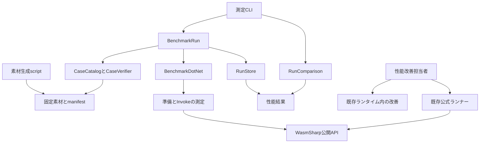
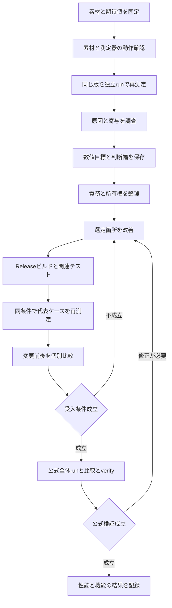

# 設計文書

## 概要

固定した代表処理を公開APIで測定し、実行時間とmanaged割り当て量の寄与を調べ、主要1〜3箇所を改善する。初期環境はWindows x64/.NET10の単一スレッド同期実行とする。[要件](requirements.md)の44受入基準を対象に、測定・結果保存・比較を`tools/WasmSharp.Benchmarks`へまとめる。

測定対象と条件を先に固定し、基準値の再測定から数値目標と悪化の判断幅を決める。最適化方式はその後に選ぶ。測定基盤の完成と性能改善の受入を分け、少なくとも1件の時間短縮またはmanaged割り当て削減の再現を仕様完了の条件にする。

### 目標

- 6個のWasm素材、15測定ケースで準備・短い呼び出し・guest計算・関数呼び出し・memory・SIMD・C由来kernelを代表させる。
- 成功した処理だけを、時間とbytes/opの同格の主指標、GC、測定条件とともに再集計可能な形で保存する。
- 公開契約、Core 2.0の意味論、診断互換性を維持し、固定公式スイート全体の比較とverifyを完了する。

### 非目標

Core 3.0、WASI、JIT/AOT、register IR、他エンジン比較、並行利用保証、全opcodeの個別計測、測定専用のランタイム公開API、性能CI、プロセス起動から最初の結果までの測定は追加しない。初期セットにはValidate単体とgrowを含めず、原因調査で必要になった場合だけ後述の追加条件に従う。

## 責務境界（Boundary Commitments）

### 本仕様が担当する処理（This Spec Owns）

- 測定ツールが素材一覧、入力、固定期待値、測定区間、反復状態、成否、結果保存と条件比較を所有する。
- 性能改善担当者が基準値の採用、原因分析、1〜3箇所の選定、変更前の数値目標、個別の改善判定を記録する。
- ランタイム変更は、選定した処理の既存の所有箇所で責務と所有権を整理してから行う。方式の具体化、必要な直接テスト、保持メモリ観測、公式回帰確認までを本仕様に含める。
- 測定基盤とランタイム変更は同じ固定ケースによる改善受入を目的とした一連の工程であり、汎用ベンチマーク製品や独立した最適化frameworkへ拡張しない。

### 対象外（Out of Boundary）

命令の意味論、公開4段階、import/exportの同一性、同期再入、診断選択の契約は先行仕様が所有する。公式ランナーの素材生成、期待値判定、結果分類、baseline保存、verifyは変更しない。固定profile、公式素材、既存baselineを性能測定のために更新しない。

### 許容する依存（Allowed Dependencies）

- 測定CLI→測定ケースと結果処理→WasmSharpの公開APIまたはBenchmarkDotNet/BCL。ランタイム→測定ツール・BenchmarkDotNet・ケースIDへの依存は禁止する。
- 素材生成script→固定WABTとClang。実行時は生成済み`.wasm`を読み、WAT/Cの解析やコンパイルを行わない。
- 固定Core 2.0設定は既存`tools/WasmSharp.TestSuiteRunner/Corpus/core2-profile.json`を読み取ってhashを保持する。ランナーassemblyへの参照や別のfeature一覧の手管理は行わない。
- ランタイム内部の依存方向は既存どおりとし、実行境界、フレーム・値の所有、memory/table資源、命令handlerの責務を混ぜない。生成器はビルド時Analyzerのままとする。

### 再検証が必要な変更（Revalidation Triggers）

- 結果・引数・スタックの所有変更: 後続Invoke、同期再入、参照寿命、trap/exhaustion/ホスト例外後の状態を再検証する。
- module処理や命令handlerの変更: 該当する既存仕様の直接テストと、固定スイート全体を再検証する。生成器自身、または生成器テストのcsprojが`EmbeddedResource`で取り込むランタイムソースを変更した場合は、生成器テストも対象とする。
- SIMD処理の変更: [先行SIMD設計](../simd/design.md)の明示的なCPU intrinsicsを採用せず、BCL/JITの最適化を意味論の前提にしない判断を維持する。通常の関連テストに加え、新しいテストプロセスへ`DOTNET_EnableHWIntrinsic=0`を指定して関連テストを再実行する。この設定によるJITの確認と、全CPU命令の無効化や他CPUでの検証は区別する。先行判断を変更する必要がある場合は、変更前に設計レビューへ戻る。
- 素材・入力・期待値・操作単位・harness・測定器・SDK/runtime・GC/JIT・電源設定変更: 旧結果との同条件比較を失効させ、別系列の性能基準値を取得する。
- 公開契約の変更、他OS/architecture、非同期・並行実行への拡張が必要なら、本仕様へ取り込まず要件へ戻る。

## アーキテクチャ

### 既存構成と先行する責務整理

`WasmModule.Decode`は静的定義を構築し、`Validate`は型検査と線形化の全体成功後に状態を確定する。成功済みValidateは再処理しない。`Instantiate`はimport接続、定義リソース、segment初期化、startを完了してからinstanceを返す。

`WasmFunction.Invoke`は公開引数を検査し、`ExecutionBoundary`が内部trap/exhaustionを公開例外へ変換する。現在の実行状態は`InterpreterContext`の`WasmValue[]`と`ExecutionFrame[]`に集約され、生成された単一switchで命令を実行する。最外側の入口ごとにコンテキストを生成し、同期再入では共有する。`Interpreter.Run`の結果配列と`WasmResults`でコピーが重なる経路、ページ単位のmemory転送、SIMDのlaneループは調査候補である。寄与と改善量は未測定であり、採用方式とはしない。

変更対象の選定後、まず当該処理の値・状態・資源の所有を既存の責務へ揃え、挙動を維持した状態で関連テストを通す。その後に最適化する。構造が既に原則を満たす箇所では、その根拠を記録し、不要なクラス抽出を行わない。

### 構成と依存方向



BenchmarkDotNetのprocess分離、計時、warmup、統計、割り当て観測を採用する。独自コードは素材と正しさ、測定結果の採用条件、再現情報、前後比較に限定する。DI container、Wasm実行エンジンadapter、独自タイマー・統計推定器は作らない。

2026-10-25の原因調査と利用者の修正指示を受け、測定基盤に限ってBDNの公開`IEngineFactory`/`IEngine`による追加統計の調整を認める。BDN0.15.8の計測準備GCが起動するArrayPool清掃の混入を防ぐため、最後のGC後にもfinalizer完了を待つ。時間測定とその自動調整・統計処理は標準エンジンへ委譲する。BDN本体の複製、private APIの書換え、カウンター値の補正は行わない。原因と再現条件は[割り当て量の調査](allocation-investigation.md)を参照する。

### 技術構成

| 対象 | 採用技術・版 | 役割と条件 |
| --- | --- | --- |
| 測定CLI | C#、net10.0 | 既存ツールと同じ実行可能project。設計調査環境のSDKは10.0.402。各runには実際のSDK/runtimeを保存する。 |
| 計時・割り当て | BenchmarkDotNet 0.15.8、MIT | .NET10対応済みの固定版。Throughput、別process、MemoryDiagnoser、JsonExporter.Full、CsvMeasurementsExporterを使用する。 |
| JSON | System.Text.Json、BCL | 素材、run、比較条件、結果を型付きDTOで保存する。 |
| 素材生成 | WABT 1.0.42+既存DataCount修正、Clang/LLD 21.1.8 | WABTは既存commit`c8dc7b6eae42b3aa3e95b9014dc02b71f8e0e1db`。ClangはC kernel生成にのみ使用する。 |
| 検証 | TUnit 1.66.16、既存公式ランナー | 新規ツールの契約テストと既存ランタイムの回帰確認。 |
| 原因調査 | .NET診断ツール | 採用時の版と引数を固定して記録する。通常の比較runと出力先を分ける。 |

BenchmarkDotNetとClangの導入・最小実行は実装工程の前提確認に含める。設計時点では導入・ビルド・性能測定を行っていない。Clang/wasm-ldは現在のPATHでは確認できていないため、生成手順に実行ファイルの指定と版検査を含める。既存のWABTビルド手順は`wast2json`だけを生成するため、素材生成用READMEには同じ固定commit・構成から`wat2wasm`と`wasm-validate`をReleaseビルドする手順も記載する。生成scriptへ両実行ファイルのpathを明示し、版・ビルド条件・実行ファイルhashを`sources.json`へ記録する。

## ファイル構成計画（File Structure Plan）

### 新規ファイル

```text
tools/WasmSharp.Benchmarks/
  WasmSharp.Benchmarks.csproj
  Program.cs                         CLIの引数と終了値
  README.md                          準備・測定・比較・診断・公式検証手順
  Cases/
    CaseCatalog.cs                   15ケースと測定メソッドの対応
    BenchmarkCase.cs                 ケース定義と操作・状態の型
    CaseObservation.cs              測定したmodule・instance・結果の段階別観測
    AssetManifest.cs                 固定素材の読込とhash照合
    CaseVerifier.cs                  公開APIで固定期待値と状態を照合
    InputFactory.cs                  固定seed・入力配列と明示型の引数
  Measurements/
    BenchmarkConfig.cs               固定Jobとexporter・diagnoser
    BenchmarkRun.cs                  実行前記録、BDN実行、結果の採用判定
    InvokeBenchmarks.cs              定常Invokeの10ケース
    PreparationBenchmarks.cs         Decode等の5ケース
  Results/
    RunManifest.cs                   run・case結果・環境の保存DTO
    RunStore.cs                      新規出力とprocess別状態の保存
    ComparisonPolicy.cs             変更前に定める数値基準の保存DTO
    RunComparison.cs                条件照合、差分と4分類の判定
  Assets/
    sources/invoke.wat              結果0・1・複数、小module
    sources/calls.wat               直接call・間接call・host loop
    sources/memory.wat              固定領域のcopyとfill
    sources/scan.wat                同じ配列のscalarとSIMD走査
    sources/kernel.c                import不要の整数行列kernel
    Prepare-Assets.ps1              変換、large WAT生成、Core2検査
    sources.json                   出典・版・条件・生成引数
    cases.json                     操作・入力・期待値・素材hashの固定値
    NOTICE.md                      素材の由来・利用条件・必要な表示
tests/WasmSharp.Benchmarks.Tests/
  WasmSharp.Benchmarks.Tests.csproj
  Cases/AssetManifest_LoadTests.cs
  Cases/CaseVerifier_VerifyTests.cs
  Measurements/BenchmarkRun_RunTests.cs
  Results/RunStore_CreateTests.cs
  Results/RunComparison_CompareTests.cs
.kiro/specs/runtime-performance/
  optimization-plan.md              基準値取得後、変更前に確定する改善計画
  acceptance.md                     性能判定と機能検証の引継ぎ
```

`RunManifest.cs`等のDTOファイルは、実装時に型ごとへ分ける場合も同じ機能フォルダ内に置く。`CaseCatalog`はメソッドとの対応だけを持ち、入力・期待値を`cases.json`と二重管理しない。新規testsは小さい異常データfixtureを同projectの`Fixtures/`に置き、通常の単体テストにClangやWABTを要求しない。

生成済み6バイナリ、large WAT、実行結果は`artifacts/runtime-performance/`へ保存する。各素材集合とrunは固有ディレクトリを持ち、同じpathへ再生成しない。受入記録にpathとhashを残し、配布時はmanifestと素材・入力を同梱する。

### 変更ファイル

| ファイル | 変更する責務 |
| --- | --- |
| `WasmSharp2.slnx` | 測定projectと対応するテストprojectを追加する。 |
| `README.md`、`.github/workflows/unit-tests.yml`、`.kiro/steering/tech.md` | 新しい測定ツールの契約テストを標準コマンドと通常CIへ追加し、既存3projectに限定した説明を更新する。通常CIの契約テストは小さい保存データfixtureを使い、BDNの起動・性能の合否判定・Clang/WABTによる素材生成は行わない。BDNの別process smokeはWindows x64での前提確認・受入手順へ置く。 |
| `src/WasmSharp/Execution/Interpreter.cs`、`ExecutionBoundary.cs`、`InterpreterContext.cs`、`src/WasmSharp/WasmResults.cs` | 呼び出し・結果所有が選ばれた場合の限定的な変更候補。 |
| `src/WasmSharp/Execution/Interpreter.Call.cs` | callの寄与が選ばれた場合の変更候補。 |
| `src/WasmSharp/WasmMemory.cs`、`Execution/Interpreter.Memory.cs`、`Interpreter.SimdMemory.cs` | memory転送が選ばれた場合の変更候補。 |
| `src/WasmSharp/Execution/SimdValue.cs`、`Interpreter.SimdInteger.cs`、`Interpreter.SimdFloat.cs` | SIMD lane処理が選ばれた場合の変更候補。 |
| `src/WasmSharp/Modules/ModuleDecoder.cs`、`ModuleValidator.cs`、`ModuleInstantiator.cs`、`FunctionValidator.cs` | 準備段階が主要因だった場合の変更候補。 |
| `tests/WasmSharp.Tests/WasmResultsTests.cs`、`WasmFunction_InvokeReentryTests.cs`、`WasmFunction_InvokeHostTests.cs`、`WasmFunction_InvokeExhaustionTests.cs`、`WasmModule_InstantiateTests.cs` | 選定箇所の所有・再入・失敗契約の直接テスト。実際の既存クラス分割に合わせる。 |
| `tests/WasmSharp.Tests/WasmFunction_InvokeBulkMemoryTests.cs`、`WasmFunction_InvokeIndirectCallTests.cs`、`WasmFunction_InvokeSimdFloatTests.cs` | memory・間接call・SIMDが変更された場合の回帰テスト。 |

候補ファイルの列挙は全箇所の変更指示ではない。基準値取得後、`optimization-plan.md`で1〜3箇所と対象ファイル・既存テストを限定する。ここにない生成器や内部補助型を変更する必要が判明した場合は、理由と責務を設計へ追記し、変更前にレビューする。ランナー、公式profile、roadmap、過去の受入記録は変更対象に含めない。

## 処理フロー（System Flows）



実装順序は「素材と最小測定→結果保存と比較→基準値→改善計画→責務整理→最適化→受入」とする。測定メソッドと結果処理はデータ契約を確定した後に分担できる。基準値がない段階で最適化タスクの方式を確定しない。

## コンポーネントと契約（Components and Interfaces）

| モジュール | 責務 | 要件 | 主要依存 | 契約 |
| --- | --- | --- | --- | --- |
| CaseCatalog・AssetManifest・CaseVerifier・素材生成script | 固定素材、操作、期待値と反復条件 | 1.1, 1.2, 1.3, 1.4, 2.6, 2.7, 3.1 | 公開API、固定profile（P0） | Batch、State |
| BenchmarkConfig・測定クラス | 測定区間と指標の取得 | 2.1, 2.2, 2.3, 2.4, 2.5, 3.4, 4.2, 5.3 | BenchmarkDotNet（P0） | Batch |
| BenchmarkRun・RunStore・RunManifest | 成否、条件、raw値の保存 | 3.2, 3.3, 4.1, 4.3, 4.4, 5.1, 5.2, 5.4, 5.6 | BDN report、ファイル（P0） | Service、State |
| RunComparison・ComparisonPolicy | 同条件の照合と事前基準による判定 | 1.5, 5.5, 6.3, 6.4, 6.5, 6.6 | 保存runとComparisonPolicy（P0） | Service |
| 改善・受入手順 | 原因選定、局所変更、寿命・意味論・回帰確認 | 4.5, 6.1, 6.2, 6.7, 6.8, 7.1, 7.2, 7.3, 7.4, 7.5, 8.1, 8.2, 8.3, 8.4 | 既存ランタイム、公式ランナー（P0） | Batch |

### 固定素材とケース

**契約: Batch / State。** `CaseCatalog`から`BenchmarkCase`を取得し、`AssetManifest.Load(string path)`が読込済みバイト列と記録したSHA-256を照合する。`CaseVerifier.Verify(BenchmarkCase definition, CaseObservation observation)`は公開操作で得た値・状態を固定期待値と照合し、`VerificationResult`として成功またはケースID・段階・期待・観測を返す。`CaseObservation`はmodule、instance、Invokeの段階別sealed recordとし、Invoke観測には所属instanceと`WasmResults`を保持する。観測recordは計時外で組み立て、計時内では既存fieldへの保持だけを行う。測定メソッドのhot pathでJSON、hash、ファイルI/Oやcase IDのswitchを処理しない。

| ケースID | 素材・測定区間 | 1操作と固定する仕事量・期待結果 |
| --- | --- | --- |
| `invoke.empty` | invoke / Invoke | 引数なし、結果0個の公開Invokeを1回。 |
| `invoke.single` | invoke / Invoke | 固定i32引数を返すInvokeを1回。結果の型・bit列を照合する。 |
| `invoke.multi` | invoke / Invoke | 固定i32・i64・f64を返すInvokeを1回。個数・順序・bit列を照合する。 |
| `loop.integer-direct` | calls / Invoke | 4,096回の整数ループ・偶奇分岐と直接call。引数と結果を固定する。 |
| `loop.float-host` | calls / Invoke | 4,096回のf64ループとhost callback。2進で正確に表せる入力・演算でbit一致を検証する。 |
| `loop.indirect` | calls / Invoke | 4,096回の間接call。tableの関数、型、固定引数と結果を照合する。 |
| `memory.copy-fill` | memory / Invoke | 64KiBのfillと64KiBのcopyを各1回。固定元領域と別の出力領域を使い、結果と出力全体を照合する。 |
| `scan.scalar` | scan / Invoke | 16,384個のu32を加算。入力`i mod 256`、期待値2,088,960。 |
| `scan.simd` | scan / Invoke | 同じ16,384個をi32x4で加算し、同じ期待値を返す。 |
| `kernel.matrix` | kernel / Invoke | 32×32のu32行列積を1回。固定seedの入力、32bit剰余演算、出力全体のhashを照合する。 |
| `decode.small` | invoke / Decode | 事前読込バイト列から小moduleを1個生成。 |
| `decode.large` | preparation-large / Decode | 256定義関数と64KiB dataを含むmoduleを1個生成。 |
| `decode-validate.small` | invoke / Decode+Validate | 毎回新しい小moduleをDecodeしValidate。 |
| `decode-validate.large` | preparation-large / Decode+Validate | 毎回新しい大moduleをDecodeしValidate。 |
| `instantiate.large` | preparation-large / Instantiate | 検証済みmoduleから新しいinstanceを1個生成。import接続、memory/table/global、data/element、startを含める。 |

15は測定ケース数、6は`.wasm`の数である。分類を重複させて全組合せを避ける。`loop.integer-direct`と`loop.float-host`はそれぞれ複合した処理であり、callだけの費用とは表示しない。`preparation-large`の関数形状、data/element内容、startが設定するglobalの値も生成条件へ固定する。startは自instanceの状態だけを変更し、共有importのhost関数は副作用を持たない。

自作WATと自作freestanding Cを採用し、初期に第三者benchmark suiteを移植しない。Cは`wasm32-unknown-unknown`、`-O2 -ffreestanding -nostdlib -fno-vectorize -fno-slp-vectorize`、LLDの`--no-entry`と必要export指定を使う。未解決symbolを許容せず、生成物のimportが0件であることを確認する。コンパイラがライブラリ呼び出しを生成する場合は成功扱いにせず、sourceまたは明示した依存と利用条件を見直す。

生成scriptは既存profileからWABT feature引数を得て、`wat2wasm`と`wasm-validate`で全素材を検査する。Core 2.0外の命令を許容するflagは付けない。Cの既定featureを互換性の根拠にせず、同じ固定profileによるバイナリ検査と公開APIの期待値照合の両方を必須にする。

`sources.json`と`NOTICE.md`は自作素材の出典revision・source hash、外部コード混入の有無、利用・再配布条件、生成ツールの版・実行ファイルhash・引数・必要な表示を保持する。自作素材にはリポジトリの配布方針を適用する。外部素材へ変更する場合は個別条件を確認してから固定する。期待値はC#の単純な独立参照計算または手計算で確定して`cases.json`に保存し、測定したWasmの出力から自動更新しない。

### 測定区間と反復状態

**契約: Batch。** `BenchmarkConfig`は`CoreRuntime.Core10_0`、`Platform.X64`、Release、`RunStrategy.Throughput`、`LaunchCount=1`、MemoryDiagnoser、MemoryRandomization無効を固定する。`DontEnforcePowerPlan()`でBDNの電源plan変更を無効にする。pilot/warmup/測定回数の調整はBDNへ委ね、Jobの設定と実際の反復数、outlier方針を保存する。初期のoutlier方針は固定版のThroughput既定`RemoveUpper`とし、除外前のActualも保存する。独立runを3回以上行って再現性を確認する。測定対象メソッドは同期処理に限定する。

`GlobalSetup`で素材hash・環境を照合し、測定前の期待値確認を行った後に測定用状態を作る。`GlobalCleanup`で最後に保持した戻り値とmemory/table/globalの必要な状態を照合する。Decodeの最後のmoduleを計時外でValidate・Instantiate・Invokeし、Decode+Validateでも計時外でInstantiate・Invokeして期待値を確認する。Instantiateは最後のinstanceの初期状態・start結果を検証する。途中のtrap・例外は測定失敗となる。

BDNはJIT、pilot、warmup、本測定に加え、割り当て観測用の反復も実行する。初期ケースは全段階で同じ処理量になるよう、読み取り専用、固定点へ戻る操作、または毎回同じ出力を上書きする操作に限定する。copy/fillは事前に最終状態へ揃え、1操作後も同じ状態へ戻る。matrixは出力全要素を毎回上書きし、前回結果を入力に使わない。table・importした実体はケース間で共有せず、callbackも累積状態を持たない。

MeasurementとSmokeは`WasmAllocationEngineFactory`を使う。標準エンジンの追加統計だけを無効にし、時間測定の後で、最終Actual反復の操作数と選択済みunrollを引き継いで追加反復を行う。`Collect→Wait→Collect→Wait→GcStats.ReadInitial→WorkloadAction→GcStats.ReadFinal`の順序とし、process全体のmanaged割り当て・GC・ThreadingStats・例外頻度を同じ反復に対応させる。IterationSetup/Cleanupはカウンターの外に置く。標準エンジンの生時間結果とoutlier方針を保持する。使用factoryはJob設定へ保存する。追加反復は標準`Run`が返した後、`BenchmarkStop`イベントより後になるため、外部の割り当てトレースはprocess終了まで採取する。

| 区間 | 計時内 | 計時外 |
| --- | --- | --- |
| Decode | 固定バイト列から新しいmoduleの生成と結果保持 | ファイル読込、変換、期待値照合 |
| Decode+Validate | 新しいmoduleのDecodeからValidate完了と結果保持 | 同上 |
| Instantiate | 検証済みmoduleの公開Instantiate全体と結果保持 | module準備、提供登録の構築、期待値照合 |
| Invoke | 公開Invoke、結果取得と消費、ケース固有の出力上書き | module/instance/export/引数準備、全出力の照合 |

Invokeの返却値はcase専用fieldへ保持し、事前に生成した`Consumer`で`WasmResults`の参照を消費する。結果0個も同じ方法とし、各値の照合は計時外で行う。参照の消費、field代入、必要な出力書込はharnessの一部として前後で固定する。検査、ログ、hash計算、LINQ、boxingを計時内へ追加しない。`OperationsPerInvoke=1`で1回の公開操作を単位とし、guest内のループ回数を操作数へ置き換えない。

短いInvokeに`IterationSetup`を付けない。Validate単体を追加するときは、各iterationの計時外に未検証moduleのバッチを新規作成し、`InvocationCount=1`、`UnrollFactor=1`で各moduleを1回だけ検証し、バッチ数を`OperationsPerInvoke`へ対応させる。grow追加時も各iterationの計時外で固定初期サイズのinstanceバッチを作り、各instanceを1回だけ同じ量だけ増大させる。これらは別Job・別ケースで記録し、短いInvokeとの共通設定に混ぜない。

### 成否と保存

**契約: Service / State。** `BenchmarkRun.Run(RunRequest request)`が実行予定case一覧を保存してからBDNを起動し、`RunStore`へ結果を渡す。`RunStore.Create(string outputDirectory, RunManifest manifest)`は既存出力先を拒否する。比較はrunを読み取るだけで、採用済みの性能基準値を更新する操作を持たない。

初期Jobの各caseは1launchとする。`GlobalSetup`と`GlobalCleanup`はrun ID・case ID・Job ID・process IDを持つprocess別JSONを計時外で保存する。前検査、実行開始、後検査完了、観測した失敗を区別する。後検査成功はBDN全体の成功ではなく、次のすべてが成立したcaseだけを`Succeeded`とする。

1. 予定したcaseの`BenchmarkReport`があり、build・validationが成功している。
2. 対応するすべての`ExecuteResult`の終了値が0で、`Errors`が空であり、結果測定行が存在する。
3. 同じcase/processの前検査・後検査が成功している。追加の診断processがあるときも対応する検査結果を要求する。
4. 時間統計、raw測定値、GCと割り当て観測が揃い、保存が完了している。

親はrun IDと絶対出力先を含むrun設定JSONを作成し、そのpathを専用環境変数`WASMSHARP_BENCHMARK_RUN_CONFIG`で子processへ渡す。子は計時外でこれを読み、case IDを測定メソッドとの固定対応から得る。run ID、process ID、出力先、この設定path、自動生成されるJob識別子は保存上の識別情報として保持し、比較条件から除外する。Jobの実効設定とGC/JIT等へ影響する環境変数は除外しない。子processが読み込んだWasmSharpと測定assemblyの実際のpath・hashを検査記録へ保存し、親のbuild出力だけで代用しない。

BDNの`IsSuccess`や`Report.Success`だけに依存しない。GlobalCleanup例外や中断を見逃さないよう、終了値・BDN error・process別記録を突合する。開始済みで完了記録のないrunは読込時にも`Incomplete`とし、完了へ補完しない。再実行は新しいrun IDで行う。

### 比較

**契約: Service。** `RunComparison.Compare(ComparisonRequest request)`は保存済みrun群と`ComparisonPolicy`を読み、`ComparisonReport`を返す。要求にbaseline/currentのrun ID一覧、事前policyのpath/hash、対象case集合を指定する。比較中に再測定・期待値変更・基準値更新を行わない。

case IDだけでなく、素材・入力・期待値・仕事量・区間・状態復元・harness・BDN Job・環境設定を照合する。変更対象のランタイムrevision/差分以外に相違があれば差異を出力して`Indeterminate`とする。入力の違うscalar/SIMDや異なる操作数の時間を同じ改善率へ混ぜない。

照合する条件は意味のある設定値と内容hashで構成する。実行時刻・保存path・前述の識別情報と、比較用ディレクトリのroot・cwdそのものは比較対象に含めない。コマンド中のproject・実行ファイル・素材の絶対pathは役割と基準rootからの相対pathへ対応付け、参照した内容hash・ツール版・意味のある引数は照合する。source集合のhashはリポジトリ内の相対pathとファイル内容を固定順に並べて計算する。測定区間・操作数・Job設定・計時内のコードを除外理由に混ぜない。assembly hashは各runで実際に使用した成果物の同定に使い、ランタイム変更やbuild先のpathに伴うhash差だけで比較不能にはしない。harnessの同一性はsource集合・依存版・ビルド条件・測定設定で判断し、ランタイムのsourceとは分けて照合する。

policyは全15ケースについて、時間と割り当ての許容増加幅、対象ケースの削減目標、同等の範囲、必要な独立run数、反復間の判断幅を保持する。閾値は絶対差または比率のどちらで判断するかを型で区別する。時間は各独立runの平均ns/opの中央値、割り当ては丸め前bytes/opの中央値を代表値とし、全runの値・最小最大・各runの信頼区間も併記する。比率と絶対差を併記し、baselineが0の指標は比率をnullとして絶対差で判定する。

判定順は「比較条件や正しさ・必要測定不足→判定不能」「いずれかの指標が事前の許容増加幅超過→悪化」「対象指標が目標達成し、他指標も許容内→改善」「両指標が同等範囲→同等」「それ以外→判定不能」とする。各指標の全runがその群の中央値から事前の反復間判断幅内にあることを先に確認し、外れた群は判定不能とする。削減目標は中央値間の差に適用し、対象指標の改善幅が基準値の同版再測定で得たノイズ幅も超えることを要求する。非対象ケースで同等より改善側に動いた場合も、事前の同等範囲とノイズ幅を超え、他指標が許容内なら改善と表示するが、選定した変更の目標達成件数には数えない。全体の比較結果はcase別結果を必ず含み、総合平均だけを出さない。

同等範囲の増加側の上限は許容増加幅以下とする。判定不能には、条件差・正しさ不成立・測定不足・ばらつき超過・目標未達・同等範囲外だが許容内、の該当理由を記録する。前4者は必要な比較が成立していないため完了を阻害する。後2者は、両指標の許容内を確認できていれば、そのケースだけで仕様全体を未完了にはしないが、改善目標の達成件数には数えない。完了には全ケースで許容内を判断できることと、選定した改善の少なくとも1件が事前目標を達成することの両方を要求する。

## データモデル（Data Models）

### 素材とケースの識別

`BenchmarkCase`は`CaseId`、`CaseRevision`、`AssetId`、`MeasurementStage`、`OperationDefinition`、`Workload`、`InputHash`、`ExpectedResult`、`StatePolicy`、`ComparisonGroup`を持つ。段階と状態方針はenum、整数値は幅と符号を明示し、Wasmの期待値は型と16進bit列で保持する。配列出力には長さ・hash方式・固定digestを保持する。NaN許容比較を追加する場合は先行仕様の規則を参照し、通常の近似比較へ置き換えない。

生成時にsource、tool、profile、生成引数、binaryのSHA-256を`asset-manifest.json`へ記録する。採用したbinary hashを`cases.json`へ固定してから基準値を取得する。変更したケースはrevisionを上げ、旧manifest・結果を残す。ファイル移動だけで意味が変わらないよう、素材pathはmanifestからの相対pathとする。

### runの保存契約

| 記録 | 内容 |
| --- | --- |
| `run.json` | schemaVersion、run ID、UTC時刻、RunKind、予定case集合、run状態、case別状態、指標、参照ファイルとhash |
| `environment.json` | CPU・OS・architecture、SDK/runtime・BDN版、Release、実効GC/JIT設定、関連環境変数、process構成、電源planと接続状態、コマンド・cwd |
| `source/` | HEAD、indexとworktreeの差分、測定に使う未追跡source/projectの内容、submodule版、対象assemblyとsource集合のhash |
| `raw/` | BDN Full JSON、measurement CSV、通常のreport、stdout/stderr・ログ |
| `checks/` | case/process別の前検査・後検査・失敗段階・観測結果 |
| `comparison.json` | 入力run ID/hash、policy hash、条件差、個別値・差・判断理由 |

同じrunに素材・case定義・Job設定のコピーを保存する。実行前後で使用source/project・assemblyのhashを照合し、途中変更があればそのrunを比較対象にしない。利用者の無関係な未追跡ファイルを無差別に収集しない。出力作成後の追記は当該run内に限定し、最後に完了状態を確定する。

case結果は`Succeeded / Failed / Unavailable / Incomplete`、run用途は`Measurement / Smoke / Diagnostic / Retention`を区別する。指標はnullableとし、取得不能の理由を必須にする。失敗はcase ID、段階、例外型・messageまたは中断理由を保持し、BDNから細かい段階が得られないprocess終了は「benchmark process終了」と最後に確認できた段階を記録する。推測したwarmup/本測定の分類を確定値として保存しない。

### 指標と集計単位

- 時間: BDNの`Workload/Result`に対応するns/op、測定数、平均、中央値、標準偏差、99.9%信頼区間とその水準。rawにはlaunch・iteration・mode/stage・操作数・経過nsを残す。Resultはoverhead中央値の控除とoutlier処理後であり、Actualとともに保存する。信頼区間はBDNの統計値であり、独立run間の差の信頼区間として扱わない。
- 割り当て: `GcStats.GetTotalAllocatedBytes(false)`、`TotalOperations`、その商の丸め前bytes/op、BDN表示のbytes/opを保存する。0.15.8の.NET10経路はprocess全体のmanaged割り当て差分であり、guestだけ・現在threadだけの値とは表示しない。
- GC: 同じ割り当て観測区間のGen0/1/2総回数、操作数、1,000操作当たりの正規化値を保存する。時間反復とは別の追加反復であることを記録する。
- BDN表示はbytes/opを丸めるため、表示0にはraw総量・操作数・丸め方式を併記する。計測上の0を割り当て不存在の証明にしない。

バッチ平均の中央値やpercentileを、個々のInvokeの遅延分布と呼ばない。managed累積割り当ては保持量・ピーク量・nativeメモリ・guest線形メモリ内の使用量とも区別する。

## エラー処理（Error Handling）

| 状況 | 応答 |
| --- | --- |
| hash/版/入力不一致、未登録case、前提不足 | 測定前に終了し、ケースまたはrunの理由を保存する。 |
| 期待値不一致、想定外のtrap・例外、後検査失敗 | 当該caseをFailed。途中の短い時間を成功指標へ採用しない。 |
| 終了異常、中断、予定case欠落 | Incomplete。存在するrawは残すが改善判定に含めない。 |
| 時間/割り当て/GCの必須値欠落 | Unavailableと理由を保存する。0で埋めない。 |
| 比較条件不一致、policy不足 | 差異を列挙して判定不能。基準を後付けしない。 |
| 出力先が存在、保存失敗 | 上書きせず終了。完了済み結果として扱わない。 |

CLIは`check --assets <manifest>`、`run --assets <manifest> --case <id|all> --output <new-directory>`、`compare --baseline <run-list> --current <run-list> --policy <path> --output <new-directory>`を提供する。終了0は各操作の成立、1は結果を保存できたがcase失敗または改善受入不成立、2は引数・I/O・未完了などの処理不成立とする。`run`の成功は性能改善の受入を意味しない。診断と保持観測は専用手順で実行し、`RunKind`を分けて保存する。

## 性能改善と受入（Performance & Scalability）

### 基準値と改善計画

全15ケースを同じ版・同じ条件で3回以上独立実行し、時間の幅と割り当ての安定性を確認する。測定器の試走はSmokeとして保存し、性能基準値に使わない。通常の測定中に電源planを自動変更せず、選んだplanと接続状態を記録して揃える。GC/JITは通常の.NET10設定を基に、BDN Jobとruntimeconfig・関連環境変数を保存する。

受入に使う基準revisionと候補revisionは、同じ測定環境・期間で順序を交互にして各3run以上を取得する。基準revisionは保存したHEAD・index/worktree差分・未追跡source/projectから独立した比較用ディレクトリへ復元し、内容hashを照合する。同じharness・素材・入力・SDK/runtimeの完全な版とビルド設定を使い、旧runを保持したまま新しい出力先へ保存する。復元・ビルド・測定の具体的なコマンドはREADMEに記載する。環境が変わった場合は既定の条件差の規則に従い、双方の再測定と事前policyの前提確認が成立するまで受入を保留し、候補の結果に合わせて閾値を後付けしない。

harnessの同一性は測定project全体と、その計時・状態検査・集計に使う共通コード、project設定、依存版の単位で判断する。基準値取得とpolicy確定の前にこれらを固定し、改善の受入まで凍結する。原因調査用のValidate単体・grow等は、凍結した測定projectを別ディレクトリへ複製した診断用の作業コピーで、その`PreparationBenchmarks`へ追加する。診断用コピーは別のDiagnostic系列として記録し、固定15ケースを測る受入用source集合へ混ぜない。

受入用harness自体の修正が必要なら進行中の候補の受入を中止し、保存した基準revisionのランタイムsourceへ修正済みharnessを組み合わせて基準値を取り直す。元のpolicyの削減目標・許容増加幅・同等範囲は全体policyを含めて保持し、更新できるのは基準側の再測定に基づくノイズ幅と反復間の判断幅だけとする。候補の結果に合わせて目標や閾値を後付けしない。元の目標・許容幅で判断できなければ候補は受け入れず、改善計画からやり直す。この前提を満たす場合だけ、候補側にも同じ修正済みharnessを使って比較する。組み合わせたruntimeとharnessそれぞれの版・source集合を記録し、旧runtimeと旧harnessのrunを新harnessの候補runへ流用しない。

`optimization-plan.md`は、採用runのID/hash、原因を示すprofile、対象1〜3箇所とケース、変更する責務、守る所有・寿命、数値目標とComparisonPolicy、必要な直接テストを変更前に保存する。具体的な数値を測定前に作らないことは未決定の設計放置ではなく、要件6.1〜6.3に従う工程上の確定条件である。

最初の変更前に、元の基準revisionに対する全15ケースの許容幅と最終目標を固定する。変更ごとの効果は直前に受け入れたrevisionを比較元とし、その比較元と変更前に定めたpolicyを改善計画に記録する。最終評価は元の基準revisionと最終revisionを交互に再測定し、最初に定めた全体のpolicyを適用する。途中の比較が許容内でも、元の基準から累積した悪化が全体の許容幅を超える場合は完了としない。

| 調査候補 | 変更前に確認すること | 変更時の制約 |
| --- | --- | --- |
| 呼び出し・結果・スタック | コンテキスト/配列/結果コピーの時間と割り当ての寄与 | 公開constructorは入力をコピーし続ける。内部で既に所有した不変結果の受渡しを整理しても、借用中のstackを結果へ渡さない。 |
| 直接/間接/host call | frame操作、構造型照合、callback引数の寄与 | 型検査、関数の同一性、定義instance、callback中の同期再入を保持する。 |
| memory・SIMD・準備 | コピー粒度、lane処理、Decode/Validate/Instantiateのprofile | 範囲確認と失敗前の部分更新禁止、数値bit列・NaN・符号付きゼロ、成功時だけの検証状態確定を維持する。 |

上表から機械的に3件選ばず、測定で裏付けられた1〜3箇所だけを変更する。時間が同等で割り当てだけが削減されても、事前目標と他条件を満たせば受け入れる。

### 再利用する場合の寿命と保持量

poolや再利用を選ぶ場合、論理的なWasm実行コンテキストと物理bufferの寿命を分ける。外側のpolicy・深さ・Stage・frame/valueの使用数は呼び出し終了時に必ず復元し、同期再入中の使用領域を貸し出さない。frameの関数・instance参照とWasmValueのexternref等は使用後に除去する。全終了経路を`finally`で扱い、上限を超えるbufferを無期限に保持しない。保持容量の上限も変更前の計画へ具体的な値と根拠を記録する。

保持観測は通常runから分離する。同じprocess数、入力、反復数、小→大→小の呼び出し列で、強制GC後のmanaged heap、保持中のinstanceの有無、private bytes等の採用指標を変更前後で比較する。heap dump等で残った参照のrootを確認し、追加した再利用が関係する所有境界にはWeakReferenceを使う最小限の直接テストを置く。強制GCやdump採取を時間比較へ混ぜない。返却済み結果が意図して保持する参照と、終了済みコンテキストの不要な参照を区別する。

### 完了条件

各変更後に対象ケースを比較し、最終版では元の基準revisionと全15ケースを再測定する。事前の許容幅を超える悪化、比較契約で完了を阻害する判定不能、正しさの不成立を残さず、最終版でも選定した変更の少なくとも1件で全体policyの時間または割り当ての目標達成を再現する。profile付きrunから改善率を採用しない。条件を揃えた再測定で改善を確認できなければ完了扱いにしない。

## 検証方針（Testing Strategy）

### 測定ツールの契約テスト

- AssetManifest/CaseVerifier: hash違い、固定期待値の不一致、scalar/SIMDの入力・仕事量一致、copy/fillとmatrixの反復後状態を確認する（1.2, 1.4, 1.5, 2.7, 3.1）。
- BenchmarkRun: 小さいBDN reportと検査結果のfixtureを用い、reportが存在しても子process非0終了、Errors、後検査失敗、必須GC欠落、予定case未完了なら成功へ採用しない（3.2, 3.3）。固定版BDNの小さな別process smokeはTUnitの通常契約テストへ含めず、Windows x64での前提確認・受入手順として別途実行し、正常時と後検査失敗の扱いを確認する。
- RunStore: 新規保存、既存出力の拒否、中断runの未完了読込、rawとcaseの対応を確認する（5.1, 5.4）。
- RunComparison: 条件差の検出、0基準の絶対差、割り当てだけの改善、他指標・他caseの悪化、欠落の判定不能を確認する。run固有の識別情報とGC/JIT等の比較条件を区別すること、変更ごとには許容内でも元の基準から累積した悪化を検出すること、判定不能の理由による完了条件の違いも確認する（4.4, 5.5, 6.4, 6.5, 6.6, 6.7）。

### 公開契約の回帰テスト

既存テストを優先し、変更で新しく生じる危険だけを追加する。結果を保持して次のInvoke/同期再入を行うこと、callback引数の参照寿命、各呼び出しのlocals初期化、異なるpolicyの独立呼び出しを確認する（7.3, 7.4）。trap/exhaustion/同じホスト例外実体の伝播後に新しい実行が成立することも対象とする。

変更箇所に応じ、同じimport実体と所属instance、memory/table境界と部分更新禁止、先行segmentの副作用保持、start失敗前に保存された参照、数値bit列とNaN・符号付きゼロを既存ケースへ対応付ける（7.1, 7.2, 7.5）。公開APIの形状を変更せず、公開memory借用ビュー等を追加しない。

### 利用者の操作を通した確認

1. 素材生成→`check`→小さいSmoke→同版全15ケースの独立run→基準値採用が、READMEのコマンドで完結することを確認する（1.1, 1.3, 2.1, 5.2, 5.3, 6.1, 8.4）。
2. 診断→事前policy→局所変更→全15ケースの比較で、個別結果と改善理由、未実施範囲が保存されることを確認する（5.6, 6.2, 6.3, 6.8）。
3. 失敗・未完了のrunをcompareへ渡し、成功した処理の性能値として採用されないことを確認する（3.2, 3.3）。

### ビルドと公式検証

実装時は`dotnet build WasmSharp2.slnx -c Release --warnaserror`の警告・エラー0を確認後、対象TUnit projectを`dotnet run --project <project> -c Release --no-build -- --treenode-filter <filter>`で実行する。テスト追加・変更時は必ず実行する（8.1）。

最終版は既存公式CLIで固定素材を全体runし、その同じ保存結果へ`compare-run`と`verify`を適用する（8.2）。設計時の参照は以下とし、実装着手時に存在とhash・直前の受入記録を再確認する。

- manifest: `artifacts/linear-memory/wabt-commit-20261016/corpus/manifest.json`
- 直前の受入済みbaseline: `artifacts/simd/task-10.3-20261018T215944Z/run-baseline.json`
- 手順: [公式ランナーREADME](../../../tools/WasmSharp.TestSuiteRunner/README.md)、[SIMD受入記録](../simd/acceptance.md)

failed、runtime_unsupported、runner_error、blocked、以前passedの回帰・欠落を0件とする。公式の既存out_of_scopeは意味を変更せず維持する。期待値、診断照合、対象集合、feature設定を緩めず、比較前にbaselineを更新しない（8.3）。必要な修正後は新しい出力先で全体run・比較・verifyをやり直す。公式検証への対応でランタイムを修正した場合は、その最終状態について性能の全15ケース比較もやり直し、同じ最終版の性能・公式検証を受入記録へ対応付ける。

性能と公式検証の最終受入がともに成立してから、比較・verifyに使った同じ保存runを既存の`baseline-save`で新しい出力先へ保存し、次回の比較元として記録する。これはランタイム変更の受入後の明示保存であり、性能測定のために公式profile・素材や比較前のbaselineを変更する操作とは区別する。従来のbaselineと過去の受入記録は残す。

`acceptance.md`には性能case別判定と機能検証の結果を分け、run ID/hash、コマンド、終了値、固定素材/profile、未実施範囲、再現可能な改善を記載する（8.4）。設計文書の完成は、この実装・性能・公式検証の完了を意味しない。

## 要件対応（Requirements Traceability）

| 要件 | 要約 | 担当 | 契約 | フロー・検証 |
| --- | --- | --- | --- | --- |
| 1.1 | 分類と件数 | CaseCatalog | 6素材・15ケース | 素材固定 |
| 1.2 | 素材・入力・操作・期待値 | AssetManifest | BenchmarkCase | check |
| 1.3 | 出典・生成・条件 | 素材生成script | sources・NOTICE | profileと期待値確認 |
| 1.4 | scalar/SIMD同条件 | CaseVerifier | ComparisonGroup | scan2ケース |
| 1.5 | 条件変更の識別 | RunComparison | CaseRevision・hash | 比較条件照合 |
| 2.1 | 4測定区間 | 測定クラス | MeasurementStage | 全15ケース |
| 2.2 | 新moduleとI/O除外 | PreparationBenchmarks | Decode系2操作 | 測定区間表 |
| 2.3 | Validate単体の追加条件 | PreparationBenchmarks | 未検証バッチ | 別Jobの追加規約 |
| 2.4 | Instantiate全体 | PreparationBenchmarks | 新instance | start後検査 |
| 2.5 | Invoke準備除外 | InvokeBenchmarks | GlobalSetup | 結果消費 |
| 2.6 | 呼出回数とguest仕事量 | CaseCatalog | Workload | 短いInvokeとloop |
| 2.7 | 可変状態と反復 | CaseVerifier | StatePolicy | 前後状態確認 |
| 3.1 | 結果照合と消費 | 測定クラス・CaseVerifier | 前後検査 | cleanup突合 |
| 3.2 | 失敗を性能値から除外 | BenchmarkRun | Failed・Incomplete | 終了値とErrors |
| 3.3 | 指標不能・未完了 | BenchmarkRun | nullable指標と理由 | 予定case突合 |
| 3.4 | grow成功条件 | PreparationBenchmarks | 固定初期サイズのバッチ | 追加規約 |
| 4.1 | 時間と割り当て | RunManifest | 同caseの主指標 | 個別出力 |
| 4.2 | 時間統計と単位 | BenchmarkConfig | raw・統計 | バッチ平均の表示 |
| 4.3 | bytes/opとGC | RunManifest | raw総量・操作数 | 別観測区間 |
| 4.4 | 表示0の扱い | RunStore | 丸め前と表示値 | 絶対差比較 |
| 4.5 | 保持量と参照寿命 | 改善手順 | Retention run | heap・参照確認 |
| 5.1 | 再集計可能な保存 | RunStore | Full JSON・CSV | 新規run保存 |
| 5.2 | revisionと環境 | BenchmarkRun | source・environment | 実行前後hash |
| 5.3 | 準備とprocess条件 | BenchmarkConfig | Job・StatePolicy | 測定区間表 |
| 5.4 | 基準値保持 | RunStore | 新規出力のみ | 上書き拒否 |
| 5.5 | 比較条件差 | RunComparison | 比較fingerprint | 判定不能 |
| 5.6 | 診断分離 | BenchmarkRun | RunKind | 診断手順 |
| 6.1 | 同版再測定 | 改善手順 | 独立run3回以上 | 基準値採用 |
| 6.2 | 原因から1〜3選定 | 改善計画 | profile・対象files | 原因分析 |
| 6.3 | 変更前の基準 | ComparisonPolicy | 数値目標・判断幅 | 計画固定 |
| 6.4 | 同条件反復比較 | RunComparison | 前後run群 | 差とばらつき |
| 6.5 | 割り当てだけの改善 | RunComparison | 指標別判定 | 比較契約テスト |
| 6.6 | 全ケースと4分類 | RunComparison | case別report | 最終全体測定 |
| 6.7 | 不成立なら未完了 | 改善手順 | 受入条件 | 修正・再評価 |
| 6.8 | 最低1件の改善 | 受入記録 | 事前目標と再現 | 完了条件 |
| 7.1 | API・段階・診断維持 | 選定ランタイム箇所 | 既存4段階 | 直接・公式テスト |
| 7.2 | 値と副作用の意味論 | 選定ランタイム箇所 | 既存命令・資源契約 | 関連テスト |
| 7.3 | 結果と再入時の所有 | 実行・結果の所有箇所 | 独立結果・locals | 再入テスト |
| 7.4 | 深さ・復元・例外 | 実行境界とコンテキスト | finally復元 | 全終了経路 |
| 7.5 | 部分更新とstart失敗 | 資源・インスタンス化 | 既存失敗契約 | 初期化・共有テスト |
| 8.1 | build後のテスト | 開発手順 | Release警告エラー0 | コマンド実行 |
| 8.2 | 全体run比較verify | 既存公式ランナー | 同じrun結果 | 最終公式確認 |
| 8.3 | 期待値等の非緩和 | 受入手順 | 固定profile・baseline | 修正と再実行 |
| 8.4 | 再実行と引継ぎ | README・acceptance | path・hash・コマンド | 性能と機能を区別 |

## 参考資料（Supporting References）

- [調査記録](research.md): 採用理由、固定版の確認、設計レビューの結果。
- [ADR 0008](../../../docs/adr/0008-instance-options-and-execution-context.md)、[ADR 0009](../../../docs/adr/0009-range-based-host-memory-access.md)、[ADR 0011](../../../docs/adr/0011-retain-references-after-start-failure.md): コンテキストと資源の所有。
- [BDN 0.15.8のGcStats](https://github.com/dotnet/BenchmarkDotNet/blob/v0.15.8/src/BenchmarkDotNet/Engines/GcStats.cs)、[setup/cleanup](https://benchmarkdotnet.org/articles/features/setup-and-cleanup.html): 指標と反復単位。
- [Clang freestanding](https://clang.llvm.org/docs/UsersManual.html#freestanding-builds)、[LLD WebAssembly](https://lld.llvm.org/WebAssembly.html): C素材の生成前提。
