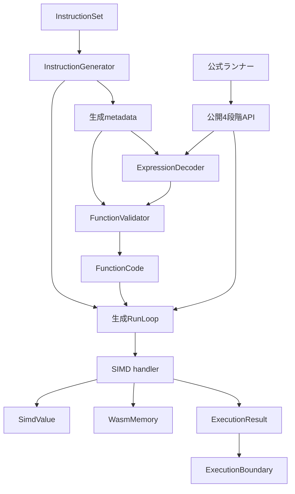

# 設計文書

## 概要

Core 2.0のSIMDを既存の命令宣言、Decode、型検証と線形化、生成された単一の実行ループへ追加する。[要件](requirements.md)の51受入基準を対象とし、公開APIは変更しない。v128は既存のWasmValueで保持し、ホストとguestが同じ値・メモリ・globalを使う。

### 目標

- 固定Core 2.0の全236個の0xFD命令とv128の共通経路を実行可能にする。
- 型効果と即値制約を命令宣言から取得し、別のSIMD opcode一覧や実行ループを作らない。
- CPU固有命令に依存しない実装で意味論を成立させ、固定公式素材と既存baselineで回帰を確認する。

### 非目標

relaxed-SIMD、threads、Core 3.0、JIT/AOT、公開vector型、CPU別backend、性能目標、新しいランナーの値判定やホスト登録は対象外とする。

## 責務境界（Boundary Commitments）

### 本仕様が担当する処理（This Spec Owns）

- InstructionMetadata: SIMDの命令宣言、順序付き数値型効果、lane上限、即値形状、生成器の整合診断を担当する。
- ExpressionDecoderとFunctionValidator: SIMD即値の保持、静的制約、型検証と線形化、v128 selectの有効化を担当する。
- SimdValueとInterpreterのSIMD handler: laneビット操作と命令の意味論を担当する。メモリ所有や公開失敗変換を取り込まない。
- ConformanceVerification: 公開経路の統合確認、固定スイートの全体実行・比較、規則対応と最後の統合のverifyを担当する。

### 対象外（Out of Boundary）

WasmValue・WasmMemory・WasmGlobalの公開契約、リソースの所有・共有、呼び出しフレーム、ConstantInitializerの評価方式、ランナーのJSON schema・期待値・診断判定・profileは維持する。先行仕様の承認やroadmapの完了状態を仕様生成のために変更しない。

### 許容する依存（Allowed Dependencies）

- Decode・Validateは静的な命令metadataと定義だけを読む。instanceやメモリ内容へ依存しない。
- SIMD handlerはSimdValue、既存InterpreterContext、WasmValue、WasmMemory.TryRead/TryWriteを使う。
- SimdValueはWasmValueとBCLだけに依存し、opcode、実行コンテキスト、ランナーを参照しない。
- ランナー→公開ランタイムの方向を守り、ランタイム→ランナー・WABT・公式ケースへの依存を作らない。
- 生成器はビルド時のAnalyzerとしてのみ参照する。内部trapの公開例外化はExecutionBoundaryだけで行う。

### 再検証が必要な変更（Revalidation Triggers）

数値signatureの表現変更では既存scalarと生成器、即値保持・線形化の変更では全命令経路、alignment共通化ではscalarメモリ、v128 selectでは数値・参照selectを再確認する。定数の型効果を追加するときはglobal・data/elementの要求型も確認する。profile・素材・変換器の更新は本機能と分離し、比較条件を再確定する。

## アーキテクチャ

### 既存構成と先行する責務整理

現状の0xFD236命令は名前のみ登録され、ExpressionDecoderが即値前に未対応を報告する。WasmValueは上下64bitを保持でき、call・locals・global・分岐は共通の値移動を使う。v128 selectだけはFunctionValidatorに明示的な未対応分岐がある。PushConstantとConstantInitializer.Evaluateは既存の即値をそのまま返せる。

挙動を追加する前に、次の変更を既存テストで確認する。

1. NumericSignatureを「同型の入力個数」から「スタック下側から上側へ並ぶ不変の入力型列と1結果型」へ整理する。既存scalar用の属性constructorは互換の記法として型列へ変換し、生成器とvalidatorの内部表現は1種類にする。
2. FunctionValidatorのmemory存在・自然alignment検査を同じ検証処理へまとめる。メモリの範囲検査は既にWasmMemoryに集約されているため再実装しない。
3. float演算に既にあるNaN結果化・符号付きゼロを保つ丸め・飽和i32変換は再利用する。min/max等で共有が必要な純粋処理だけを先に抽出し、スカラーの挙動を保持する。pmin/pmaxの意味論は混ぜない。

### 構成と依存方向



矢印は生成物・データ・呼び出しの流れを表す。コード上ではModulesとExecutionがInstructionsの静的契約を参照し、SimdValueとWasmMemoryはその利用者を参照しない。単一の生成RunLoopから各handlerを直接呼び、delegate表やSIMD専用の第2dispatchは追加しない。

### 技術選択

| 対象 | 採用 | 判断 |
| --- | --- | --- |
| ランタイム | 既存.NET 10・C#、ulongと固定幅整数・float/double・BinaryPrimitives | lane単位の移植可能な処理。新規packageなし。 |
| 生成器 | 既存netstandard2.0・C# 13・Roslyn | 属性の入力型列とlane制約を読み、既存のmetadataと直接呼び出しを生成する。 |
| テスト | 既存TUnitと公式ランナー | C#・AAA・日本語命名規則を維持する。 |
| CPU支援 | 明示的なCPU intrinsicsを採用しない | SIMDの有無による未対応を避ける。BCL/JITの最適化は意味論の前提にしない。 |

## ファイル構成計画（File Structure Plan）

以下の担当名をtasksの_Boundary:_で使用する。記載のない既存依存は再利用するだけで、変更対象にしない。

| 担当 | 新規・変更先 | 責務 |
| --- | --- | --- |
| InstructionMetadata | 変更: src/WasmSharp/Instructions/InstructionSet.cs、InstructionAttribute.cs、NumericSignature.cs、ImmediateKind.cs、StackEffectKind.cs、ValidationRule.cs、MemoryAccessSignature.cs | 共通命令宣言、固定型効果と即値制約。MemoryAccessSignatureはvectorを含めた契約説明・制約を整える。 |
| InstructionMetadata | 変更: src/WasmSharp.Generators/InstructionGenerator.cs、AnalyzerReleases.Unshipped.md | 入力型列・lane制約・vectorメモリ宣言の検査と生成。診断を追加した場合はrelease定義を更新する。 |
| ExpressionDecoder | 変更: src/WasmSharp/Modules/ExpressionDecoder.cs、DecodedInstruction.cs | SIMD即値の読み取りと所有。 |
| FunctionValidator | 変更: src/WasmSharp/Modules/FunctionValidator.cs、src/WasmSharp/Execution/Instruction.cs | 型・即値制約と実行表現への引渡し。 |
| ConstantInitializer | 再利用: src/WasmSharp/Modules/ConstantInitializer.cs、src/WasmSharp/WasmInstance.cs | v128.constを既存の定数式検証・global生成経路へ接続する。専用評価器を追加しない。 |
| SimdValue | 新規: src/WasmSharp/Execution/SimdValue.cs | 128bitのlane取得・置換・byte順変換。 |
| ScalarFloatSemantics | 変更: src/WasmSharp/Execution/Interpreter.Float.cs、Interpreter.Conversion.cs | 共通化が必要な純粋演算だけを抽出し、既存補助を再利用可能にする。 |
| SimdLaneExecution | 新規: src/WasmSharp/Execution/Interpreter.SimdLane.cs | splat・extract・replace・shuffle・swizzle・論理・比較・reduction。 |
| SimdIntegerExecution | 新規: src/WasmSharp/Execution/Interpreter.SimdInteger.cs | 通常整数・飽和・シフト・平均・拡張・積和。 |
| SimdFloatExecution | 新規: src/WasmSharp/Execution/Interpreter.SimdFloat.cs、Interpreter.SimdConversion.cs | 浮動小数点とvector数値変換。 |
| SimdMemoryExecution | 新規: src/WasmSharp/Execution/Interpreter.SimdMemory.cs | vectorの変換と指定幅のメモリアクセス。 |
| 上記各担当 | 新規: tests/WasmSharp.Tests/Execution/SimdValue_*Tests.cs、Interpreter_*Tests.cs | 各操作単位の意味論・境界値テスト。各クラスは対象メソッドごとに分ける。 |
| ExpressionDecoder・FunctionValidator | 変更: tests/WasmSharp.Tests/Modules/ExpressionDecoder_ReadTests.cs、ModuleDecoder_DecodeFailureTests.cs、ModuleDecoder_DecodeInstructionTests.cs、ModuleDecoder_ReadElementTests.cs、ModuleValidator_ValidateSelectTests.cs。新規: Modules/ModuleValidator_ValidateSimdTests.cs | 切断・不正即値・型不一致・到達不能・select・検証成功状態。SIMD接続で成立しなくなる未対応期待も見直す。 |
| InstructionMetadata | 変更: tests/WasmSharp.Tests/Instructions/InstructionSet_TryGetTests.cs、tests/WasmSharp.Generators.Tests/InstructionGenerator_InitializeTests.cs、InstructionGenerator_InitializeMemoryTests.cs、WasmSharp.Generators.Tests.csproj | 固定236命令との対応、生成診断、runtime契約ソースのEmbeddedResource。 |
| ConformanceVerification | 変更: tests/WasmSharp.Tests/Fixtures/HostLinkingModuleBinary.cs、WasmModule_DecodeTests.cs、WasmModule_DecodeDataTests.cs、WasmModule_DecodeGlobalsTests.cs、WasmModule_InspectImportsTests.cs。新規: Fixtures/SimdHandlerFixture.cs、WasmFunction_InvokeSimdTests.cs、WasmModule_InstantiateSimdTests.cs | 入力fixture、公開4段階と共通経路の統合確認。SIMD接続後も診断位置・検査順・非実行とimport情報の未確認範囲を検証する。 |
| ConformanceVerification | 新規: .kiro/specs/simd/acceptance.md、artifacts/simd/配下の実行ごとの新規出力 | 規則対応と実行結果・比較・verify。成果物は実装時に作成する。 |

既存のModules・Execution配置とnamespaceを維持する。Interpreterのpartialファイルで演算群を分け、別インタープリタ型を作らない。型名・メソッド名は実装時も既存の命名を優先する。

## 処理の流れ（System Flows）

```mermaid
sequenceDiagram
    participant User as 呼び出し元
    participant Module as WasmModule
    participant Validator as FunctionValidator
    participant Instance as WasmInstance
    participant Loop as Interpreter
    participant Memory as WasmMemory
    User->>Module: Decode
    User->>Module: Validate
    Module->>Validator: 即値制約と型検証
    Validator-->>Module: FunctionCode
    User->>Module: Instantiate
    Module->>Instance: 定数式でglobalを初期化
    User->>Loop: Invoke
    Loop->>Memory: 指定幅のTryReadまたはTryWrite
    Memory-->>Loop: 成否
    Loop-->>User: 結果または境界で変換したtrap
```

startも同じ実行ループを使う。globalのv128.const初期化はstartより前で、SIMD演算を初期化式として実行しない。失敗時に先行する成功済み副作用を巻き戻す仕組みは追加しない。

## 要件対応（Requirements Traceability）

| 要件 | 内容 | 担当 | 契約・確認経路 |
| --- | --- | --- | --- |
| 1.1, 1.2, 1.3, 1.4, 1.5 | バイナリと即値 | InstructionMetadata、ExpressionDecoder | 即値形式、byte列・Stream |
| 1.6 | 段階・位置・診断 | ExpressionDecoder、FunctionValidator、SimdMemoryExecution、ConformanceVerification | 既存例外・ExecutionResult |
| 2.1, 2.2, 2.3, 2.4, 2.5, 2.7 | 型・静的制約 | InstructionMetadata、FunctionValidator | 型列、LaneCount、memory幅、公開Validate |
| 2.6, 3.2, 3.5 | 定数・global | ConstantInitializer、FunctionValidator、ConformanceVerification | Immediate、既存global初期化 |
| 3.1 | ビット保持 | SimdValue | FromV128・AsV128、lane 0 |
| 3.3, 3.4, 3.6 | 共通値経路 | FunctionValidator、ConformanceVerification | select、call、control、host、start |
| 4.1, 4.2, 4.3, 4.4, 4.5, 4.6 | lane・論理・比較 | SimdLaneExecution | 共通handler契約 |
| 5.1, 5.2, 5.3, 5.4, 5.5, 5.6 | 整数 | SimdIntegerExecution | 共通handler契約 |
| 6.1, 6.2, 6.3, 6.4, 6.5 | 浮動小数点・変換 | ScalarFloatSemantics、SimdFloatExecution | 共通handler契約 |
| 6.6 | CPU非依存 | SimdValue、全SIMD実行担当、ConformanceVerification | 移植可能なlane処理 |
| 7.1, 7.2, 7.3, 7.4, 7.5, 7.6, 7.7 | メモリ | SimdMemoryExecution、ConformanceVerification | TryRead/TryWrite、Invoke・start |
| 8.1, 8.2, 8.3, 8.4, 8.5, 8.6, 8.7 | 公式受入 | ConformanceVerification | run・compare-run・baseline-save・verify |

## 構成要素と契約（Components and Interfaces）

### InstructionMetadata

**担当:** 要件1.2, 1.3, 2.1, 2.2, 2.3, 2.4。契約は静的な状態。入力はInstructionSetの属性、出力は生成metadataと直接dispatch。依存は生成器（External/P0）、validatorとdecoder（Inbound/P0）。

- NumericSignatureは`ImmutableArray<WasmValueKind> InputTypes`と`WasmValueKind ResultType`を持つ。入力は1〜3個、型はI32/I64/F32/F64/V128、結果は同集合の1型とする。関数や制御の動的型効果には使わない。
- 既存のcount/type/result属性constructorは同型列を作る。新しい属性constructorは`WasmValueKind[] inputTypes, WasmValueKind resultType`を受けてコピーする。生成器は両記法を同じ不変の型列へ変換し、pop順は逆順とする。
- NumericSignature自体の等値比較は処理契約に含めない。既存の命令集合テストと生成器テストは新しいconstructorへ追随し、入力型列を順序付きで要素比較して結果型を別に確認する。テストのためだけに構造的なEquals/GetHashCodeを追加しない。
- 数値のmixed入力は宣言に明記する。shiftは[V128,I32]、replaceは[V128,scalar]、bitselectは[V128,V128,V128]、extractは[V128]→scalar、比較は[V128,V128]→V128、reductionは[V128]→I32。
- ImmediateKindへV128、Shuffle、LaneIndex、MemoryArgumentLaneIndexを追加する。定数にはPushV128とValidationRule.Constantを使う。
- lane即値を持つ宣言には名前付き属性`LaneCount`（byte）を追加し、生成metadataにも保持する。16/8/4/2と命令のlane幅を対応させる。shuffleの要素上限32はShuffle即値形状の規則とする。
- MemoryAccessSignatureのValueTypeにV128、ByteWidthに16を追加許可する。vector拡張loadの符号はhandlerの意味論で扱い、既存のscalar専用SignExtendを流用しない。通常vector load/storeには既存MemoryLoad/MemoryStore、lane load/storeには専用の検証規則を追加する。
- 生成時に不正な入力列、lane制約の欠落・不整合、memory形状・幅の不整合、handler欠落を拒否する。0xFDの対応済み集合は固定付録から導出するテストと照合し、手書きの第2命令表を置かない。

### ExpressionDecoder・FunctionValidator

**担当:** 要件1.1〜2.7、3.4。契約は既存のDecodeとValidate。命令metadata（Outbound/P0）だけを型規則の出発点とする。

- V128は16byteをlittle-endianの上下ulongへ変換し、WasmValueとしてImmediateに保持する。
- Shuffleはコピーした`ImmutableArray<byte> ShuffleLanes`、laneは`byte LaneIndex`をDecodedInstructionとInstructionに追加して保持する。memarg＋laneは両方を保持し、既存Indexへ意味の異なる即値を詰め込まない。
- Decoderはbyteの範囲内でlane値をそのまま読む。shuffleの32以上、lane上限、alignmentはValidateの責務とする。
- FunctionValidatorはNumericSignatureの型列を逆順にpopし、結果型をpushする。lane/shuffle検査は到達不能でも省略せず、既存Popのpolymorphismを利用する。
- memory存在・alignmentの共通検査後、通常loadは[i32]→v128、storeは[i32,v128]→[]、load_laneは[i32,v128]→v128、store_laneは[i32,v128]→[]とする。alignment上限はMemoryAccessSignature.ByteWidthから求める。
- v128 selectの未対応分岐だけを除き、型・個数・i32条件の検査は維持する。global初期化のv128.constは既存ConstantInitializerへ流す。
- 検証成功時だけFunctionCodeを公開する。診断選択の順序は固定参照実装と公式否定ケースで確認し、入力位置を線形化後も保持する。

### SimdValue

**担当:** 要件3.1, 4.1, 6.6。契約は内部の値操作。依存はWasmValue・BCL（Outbound/P0）のみ。

内部readonly structとして上下ulongを保持し、`FromValue(WasmValue)`、`ToValue(): WasmValue`、`GetLane(int bitWidth, int laneIndex): ulong`、`WithLane(int bitWidth, int laneIndex, ulong bits): SimdValue`、16byteのlittle-endian変換を提供する。lane幅は8/16/32/64、indexは検証済みであり、64bit幅のmask・shiftはC#のシフト量剰余による誤りを避ける。命令ごとの符号解釈・浮動小数点変換はhandlerに残す。操作ごとの配列確保や公開vector型を要求しない。

### SIMD実行担当

**共通契約:** `internal static ExecutionResult Handler(InterpreterContext context, in Instruction instruction)`。既存生成ループから呼ばれ、operandを取り出して結果をpushし、成功時は既存のdefault結果を返す。Immediate等はValidate済み。新しい外部APIやエンドポイントは0件。

新規SIMD handlerは、接続前には生成されないExecutionOpcodeの列挙子を参照しない。命令固有のlane幅や演算種はhandlerから純粋処理へ渡し、共通化できる処理を共有する。MemoryAccessSignatureなどInstructionが保持する検証済み情報で処理を選べるhandlerは共有してよい。SimdHandlerFixtureは必要な即値・アクセス情報とoperandを渡し、生成opcodeに依存せず接続前のhandlerを確認する。

| 担当 | 入力・結果の規則と実装上の決定 |
| --- | --- |
| SimdLaneExecution | 8/16/32/64bitの整数、f32/f64のsplat・extract・replace。shuffleは下側operandを先頭16byteとする。swizzleの16以上はゼロ。比較結果はlane幅全bit1/0。bitmaskはlane番号順。bitselectはmask=1で下側候補を選ぶ。 |
| SimdIntegerExecution | 通常演算の折返し、shift量mod lane幅、signed入力からunsigned出力へ飽和するnarrow、切上げ平均を個別に扱う。extend/extmulはlow/highを分ける。pairwise・dot・q15は中間幅を確保し、dotの加算折返しとq15の最小値同士の飽和を確認する。 |
| SimdFloatExecution | abs/negはbit操作。算術・丸めは既存の同精度の補助を再利用する。min/maxはNaNと±0の規則、pmin/pmaxは比較で選ばれたoperandのbitを保持する。飽和変換はNaN→0と上下限、demote/promoteとzero系は対象laneと残りのゼロ化を扱う。 |
| SimdMemoryExecution | i32をuintとしてulongへ拡張しoffsetを加算。最大16byteの一時領域のうちByteWidth分だけTryRead/TryWriteへ渡す。load変換とstore抽出はhandlerが担当し、範囲外はMemoryOutOfBoundsと関数index・byte位置を含むExecutionResultを返す。 |

メモリのByteWidthは、v128.load/store=16、load8x8/16x4/32x2=8、load32_zero=4、load64_zero=8、splatとlaneはlane幅/8とする。zero loadにはlane即値を付けない。整列指定は静的な上限であり、実行時の非整列アドレスを拒否しない。load_laneは既存vectorをpopしてからaddressをpopし、storeもvalue→addressの順で扱う。

### ConformanceVerification

**担当:** 要件3の共通経路、7.6, 7.7, 8.1〜8.7。契約は既存CLIのBatchと公開APIの統合テスト。公式ランナーと固定素材（External/P0）に依存する。

設計時点の比較元は[tables-referencesの最終保存](../tables-references/acceptance.md#84-比較済み結果の明示baseline保存)である。

- baseline: `artifacts/tables-references/task-8.4-20261018T090714Z/run-baseline.json`
- manifest: `artifacts/linear-memory/wabt-commit-20261016/corpus/manifest.json`
- spec: `05ca4182176763112561ae20153975c12bd689e4`、WABT: `c8dc7b6eae42b3aa3e95b9014dc02b71f8e0e1db`
- 147入力・53,907command。受入記録の残りはruntime_unsupported=1,079、blocked=24,269で、SIMD起因として監査済み。実装開始時に現物・hash・最新受入を再確認する。

公式スイート全体のrunとcompare-runを、公開経路へ接続した機能単位で行う。結果は毎回新規出力へ保存し、直前の受入baselineを最終確認まで保持する。絞込みやhandlerテストだけを全体確認の代用にしない。

## データモデル（Data Models）

永続化方式は追加しない。WasmValueの128bit、DecodedInstructionの不変即値、Validateで作るInstructionを使う。入力バッファを保持せず、返却済み値・globalの共有・instanceごとの定義リソースという既存の所有規則を維持する。型効果とlane制約の生成metadataは読み取り専用で、命令ごとの実行中状態を置かない。

## 失敗処理（Error Handling）

| 状況 | 処理 |
| --- | --- |
| 不正LEB128・切断・未割当0xFD | Decodeの既存例外。予約opcodeを一般的なunsupportedへ変えない。 |
| lane・shuffle・alignment・operand・定数式違反 | Validateの既存例外。型検査失敗では検証成功状態を確定しない。 |
| メモリ範囲外 | ExecutionResultのtrap→ExecutionBoundaryで公開例外。失敗storeは未変更。 |
| ホストcallback例外・exhaustion | 先行仕様の型・実体・コンテキスト復元を維持する。 |
| 開発途中の未接続命令 | 既存unsupportedを保持する。handlerまで揃った命令だけを接続し、成功する仮handlerは作らない。 |

## 検証方針（Testing Strategy）

### 局所的な検証

- 1.1〜2.7: 0xFDの1byte/複数byte/許容非最短LEB、切断、予約番号、16byte即値、lane上限直前と上限、shuffle31/32、memory不在、alignment境界、mixed入力逆順、到達不能と定数式型不一致を検証する。
- 3.1〜4.6: 上下64bitをまたぐlane、NaN payload、±0、全bitゼロ・全bit1、shuffle両operand端、swizzle15/16/255、signed/unsigned extract、bitselect・比較・bitmaskを確認する。
- 5.1〜5.6: laneの最小・最大、overflow、全lane幅以上のshift、unsigned narrowの負入力、平均の奇数和、low/high順序、dotのoverflow、q15最小値同士を確認する。
- 6.1〜6.6: 両精度のNaN・±0・無限大・非正規化数、nearestの偶数丸め、pmin/pmaxのoperand順、飽和境界の内外、zero系の上位laneを確認する。CPU依存分岐を作らない設計を確認し、最終検証では新しいテストプロセスに`DOTNET_EnableHWIntrinsic=0`を指定してSIMD handlerの関連テストだけを一度再実行する。通常実行と同じ期待値を使い、環境条件・コマンド・件数・終了値をacceptance.mdへ記録する。この設定は[.NETのSIMD検証手順](https://learn.microsoft.com/en-us/dotnet/standard/simd)に従うJITの設定による確認であり、BCL内部や事前コンパイル済みコードを含むCPU命令の全面無効化、異なるCPU・OSでの実行確認とは区別する。
- 7.1〜7.5: 各アクセス幅の末尾ぴったり・1byte超過、ページ境界、非整列、最大uintアドレスとoffset、部分書込みなし、load_laneの非対象lane保持を確認する。

### 公開経路の統合確認

3.2〜3.6をDecode→Validate→Instantiate→Invokeで確認し、v128のconst/global/locals/複数値/直接call/間接call/分岐/select/ホストcallback/同期再入を既存fixtureへ組み込む。7.6, 7.7は共有memory、data初期化、grow後、scalarとの混在、Invokeとstartのtrap後の状態・次の呼び出しを確認する。既存の未対応期待は該当機能を接続した時点で更新する。

未対応期待の見直しは、`tests/WasmSharp.Tests/`配下の次の9テストファイルを対象とする。

- `Modules/ExpressionDecoder_ReadTests.cs`
- `Modules/ModuleDecoder_DecodeFailureTests.cs`
- `Modules/ModuleDecoder_DecodeInstructionTests.cs`
- `Modules/ModuleDecoder_ReadElementTests.cs`
- `Modules/ModuleValidator_ValidateSelectTests.cs`
- `WasmModule_DecodeTests.cs`
- `WasmModule_DecodeDataTests.cs`
- `WasmModule_DecodeGlobalsTests.cs`
- `WasmModule_InspectImportsTests.cs`

完全なSIMD入力は接続後の正常なDecode・Validateへ、即値の欠けた入力はDecode失敗へ、定数式や型の不適合はValidate失敗へ置き換える。診断の再走査・位置・検査順、Decode/InspectImportsが実行しないこと、import情報の未確認範囲という独立した検証目的は、接続後も成立する入力で維持する。未対応状態そのものだけを検査するケースは対応命令の接続時に廃止し、失われる検証対象と理由をacceptance.mdへ記録する。テスト用に未対応命令や注入機構を作らない。

v128 selectの明示的な未対応分岐は接続時に除去する。その他の未対応分類・公開例外・未確認範囲の契約と汎用の宣言判定・例外変換は既存契約として維持し、本仕様では削除しない。全命令接続後は固定Core 2.0の正常入力から未対応を発生させる命令が残らないことを確認し、残した経路の到達性と保持理由をacceptance.mdへ記録する。

### 公式受入と最終判定

1. `dotnet build WasmSharp2.slnx -c Release --warnaserror`の警告・エラー0を確認後、変更に関連するTUnitを実行する。最終時は3テストプロジェクトをRelease・--no-buildで実行する。
2. 固定manifestで全体の`run`を完了し、その出力へ`compare-run`を適用する。command単位でSIMD対象と既存passedを確認し、51受入基準を固定規則・実装・確認結果へ対応付ける。
3. 問題をランタイム側で修正し、必要なbuild・test・run・比較を再実行する。期待値変更、ケース除外、profile縮小は解決としない。
4. 全8仕様の統合状態で単一の最終runへ`verify`を適用する。SIMD機能受入とCore 2.0全体判定を別に報告し、未対応やblockedが残れば全体完成としない。
5. 比較・受入済みの同じ結果JSONを`baseline-save`で明示保存し、入力と保存結果の一致を確認する。保存成功から合格を推測しない。

新しい結果・比較・コマンドの終了値・規則対応はacceptance.mdから参照する。仕様生成時にはこれらの実行を行ったと記録しない。

