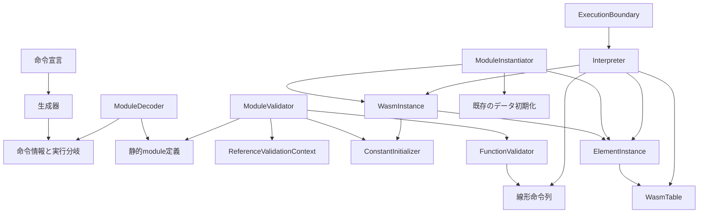
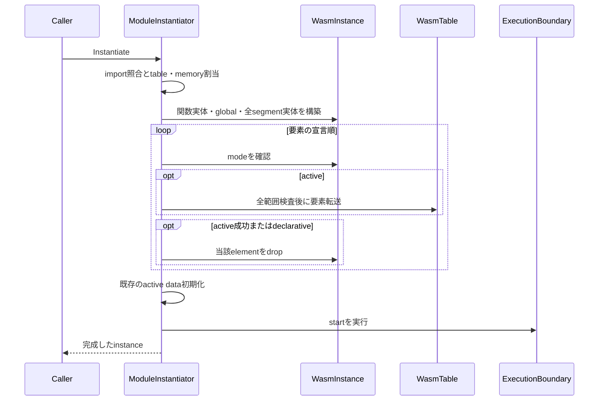

# 設計文書

## 概要

既存の値・テーブル・関数呼び出しを拡張し、Core 2.0の参照命令、テーブル命令、要素セグメント、間接呼び出しを公開4段階へ接続する。
公開APIは追加せず、WasmValue、WasmTable、WasmFunction、WasmInstanceの同一性と例外契約を維持する。

### 目標

- [要件](requirements.md)の55受入基準を、固定Core 2.0の規則と公開経路の検証に対応付ける。
- テーブルの領域操作、要素の寿命、命令実行、インスタンス構築を既存の責務に沿って分離する。
- 要素・データ・startの順序と失敗後の副作用を、現在のlinear-memoryと統合する。

### 非目標

GC、型付き関数参照、call_ref、table64、SIMDの実装、公開テーブル操作の再設計、汎用ストアや差し替え可能なアロケーターは導入しない。
ランナーの期待値・分類・固定プロファイル・公式素材も変更しない。

## 責務境界（Boundary Commitments）

### 本仕様が担当する処理（This Spec Owns）

- 参照とテーブルの命令情報、即値、静的検証、線形化、実行を担当する。
- moduleが持つ不変のElementDefinitionと、instanceが持つElementInstanceを追加する。
- ref.funcの宣言集合と参照定数式を検証し、関数実体の生成を初期化式の評価より先へ移す。
- 要素初期化と既存のデータ初期化・startを接続し、table系trapの公開診断を補う。
- 対象公式ケースの受入と既存passedの回帰確認を行う。

### 対象外（Out of Boundary）

- host-linkingのimport解決・型照合・公開値・リソース共有、numeric-controlの制御スタック、linear-memoryのデータ命令を再実装しない。
- ホストからのWasmTable.Get/Set/TryGrowの引数検査順、例外、同一性を変更しない。
- ランタイムに公式JSON、テスト識別子、spectest、参照比較用レジストリを持ち込まない。
- 本書の作成では製品コード、テスト、baseline、上流仕様の完了状態を変更しない。

### 許容する依存（Allowed Dependencies）

- 命令宣言から生成するmetadataをDecode・Validate・Interpreterが参照する。生成器はビルド時のみ依存する。
- 静的検証はmodule定義とReferenceValidationContextを使用し、実行中のtableやinstanceへ依存しない。
- Interpreterは現在の定義関数の所属instanceから関数・table・elementを取得する。
- ElementInstanceはWasmTableへ範囲転送を依頼する。WasmTableは命令、element、Interpreter、ランナーに依存しない。
- WasmInstanceは関数とリソースの構築済み状態を所有する。ModuleInstantiatorはリンクと、共有領域への初期化・startの実行順序を所有する。
- ExecutionBoundaryだけがExecutionResultのtrapを公開例外へ変換する。

### 再検証が必要な変更（Revalidation Triggers）

- インスタンス構築順を変更するときは、host-linkingのglobal・関数同一性・import/export・startとlinear-memoryの失敗副作用を再確認する。
- 共通呼び出し処理を抽出するときは、直接call、ホストcallback、同期再入、深さ上限、例外後の復元を再確認する。
- 即値とExecutionResultを変更するときは、生成器の埋込みソース、数値・制御・メモリの既存命令を再確認する。
- 固定素材や比較元を移行するときは、受入済み結果との関係を上流の移行手順で確定する。実装途中の結果を比較元へ置き換えない。

## アーキテクチャ

### 既存構成と先行する責務整理

WasmTableはWasmValue配列を所有し、Get/Set/TryGrowを提供する。
WasmValueはfuncref・externrefと型別nullを保持でき、追加localも型別nullで初期化される。
FunctionValidatorは参照typed selectの型検証後に未対応を報告する。
対象opcodeはInstructionSetへ登録済みだが、実行契約はまだ指定されていない。

現在のModuleInstantiatorはglobal初期化後にWasmInstanceを作り、WasmInstanceのコンストラクターが定義関数を作る。
この順序ではglobal初期化式のref.funcを解決できない。
挙動を追加する前に、次の3点を既存テストで維持できる形へ整理する。

1. WasmTableの範囲検査と要素の読み書きを内部Try操作へ集約し、公開操作は従来の引数検査と例外を維持する。
2. Interpreter.Callの関数解決後の処理をCallFunctionへ抽出し、直接callを同じ処理へ戻す。
3. WasmInstanceの内部構築契約をimport済みglobalを受け取る形へ変更し、関数実体、定義global、segment実体の順に構築する。ModuleInstantiatorからglobal生成を移し、未完成instanceは外部へ公開しない。

### 構成と依存方向



矢印は処理上の参照・生成を示す。
instance内の循環参照は既存のDefinedFunctionが所属instanceを保持する関係だけを使い、関数を仮実体から置き換えない。
BCLの配列・Span操作を採用し、別の実行エンジンや公開抽象を追加しない。

### 技術

| 対象 | 選択 | 役割 |
| --- | --- | --- |
| ランタイム | 既存C# / .NET 10 | ImmutableArray、ReadOnlySpan、配列による型付き参照の保持 |
| 命令生成器 | 既存netstandard2.0 / Roslyn | metadataとhandlerへの直接分岐を生成 |
| テスト | 既存TUnitの3プロジェクト | 公開経路、内部の範囲処理、生成結果を検証 |
| 公式受入 | 既存TestSuiteRunner | 固定素材のrun、compare-run、baseline-save |

追加パッケージ、OS依存処理、unsafeは不要である。

## ファイル構成計画（File Structure Plan）

パスはリポジトリルートを基準とする。
担当名はタスクの_Boundary:_と一致させる。

| 担当 | 変更する既存ファイル | 追加するファイルと責務 |
| --- | --- | --- |
| InstructionDefinitions | src/WasmSharp/Instructions/InstructionSet.cs、ImmediateKind.cs、ValidationRule.cs、StackEffectKind.cs、src/WasmSharp/Modules/DecodedInstruction.cs、src/WasmSharp/Execution/Instruction.cs | なし。2添字と参照型即値を既存の命令表現へ追加 |
| ModuleDecoder | src/WasmSharp/Modules/ModuleDecoder.cs、ExpressionDecoder.cs、src/WasmSharp/WasmModule.cs | src/WasmSharp/Modules/Definitions/ElementDefinition.cs：mode・型・式・位置の不変定義 |
| ReferenceValidation | src/WasmSharp/Modules/ModuleValidator.cs、FunctionValidator.cs | src/WasmSharp/Modules/ReferenceValidationContext.cs：当該Validate内で共有する添字型と宣言集合 |
| ConstantInitializer | src/WasmSharp/Modules/ConstantInitializer.cs | なし。参照の定数式規則と評価 |
| WasmTable | src/WasmSharp/WasmTable.cs | なし。内部の要素・範囲操作 |
| ElementInstance | なし | src/WasmSharp/Execution/ElementInstance.cs：評価済み参照列、転送、破棄 |
| InstanceConstruction | src/WasmSharp/WasmInstance.cs、src/WasmSharp/Modules/ModuleInstantiator.cs | なし。構築順と要素初期化の接続 |
| ReferenceExecution | なし | src/WasmSharp/Execution/Interpreter.Reference.cs：ref命令のhandler |
| TableExecution | なし | src/WasmSharp/Execution/Interpreter.Table.cs：table命令とelem.dropのhandler |
| FunctionDispatch | src/WasmSharp/Execution/Interpreter.cs | src/WasmSharp/Execution/Interpreter.Call.cs：抽出した直接call、共通呼び出し、間接call |
| ExecutionBoundary | src/WasmSharp/Execution/ExecutionResult.cs、ExecutionBoundary.cs | TrapDiagnosticKindはExecutionResult.csに同居させる |
| ConformanceVerification | 既存の公式ランナーを使用 | artifacts/tables-references/配下に実装時の実行・比較結果を保存 |

生成器本体は新しい属性形式を設けずに拡張できる。
ImmediateKind・ValidationRule・StackEffectKindのenum名を既存生成経路へ渡し、InstructionGeneratorの変更は生成契約のテストで必要性が確認された場合に限定する。

テストは次の配置とする。
テーマ別ファイルでも既存のpartialテストクラスを使い、クラス名は対象クラス_対象メソッドTestsを維持する。

| 種類 | 追加または変更するファイル |
| --- | --- |
| 共有fixture | tests/WasmSharp.Tests/Fixtures/HostLinkingModuleBinary.csとExecutionInstanceFixture.csを拡張する場合は準備タスクに集約 |
| Decode | tests/WasmSharp.Tests/WasmModule_DecodeElementTests.cs、Modules/ExpressionDecoder_ReadTests.cs、Modules/ModuleDecoder_ReadElementTests.cs |
| Validate | tests/WasmSharp.Tests/WasmModule_ValidateReferenceTests.cs、WasmModule_ValidateElementTests.cs、Modules/FunctionValidator_ValidateTableTests.cs、Modules/ConstantInitializer_ValidateTests.cs |
| テーブル領域 | tests/WasmSharp.Tests/WasmTable_TryGetTests.cs、WasmTable_TrySetTests.cs、WasmTable_TryWriteTests.cs、WasmTable_TryCopyTests.cs、WasmTable_TryFillTests.csと既存Get/Set/TryGrowTests |
| 要素の寿命 | tests/WasmSharp.Tests/Execution/ElementInstance_TryInitializeTests.cs、ElementInstance_DropTests.cs |
| 公開実行 | tests/WasmSharp.Tests/WasmFunction_InvokeReferenceTests.cs、WasmFunction_InvokeTableTests.cs、WasmFunction_InvokeIndirectCallTests.cs |
| 初期化と共有 | tests/WasmSharp.Tests/WasmModule_InstantiateElementTests.cs、WasmModule_InstantiateReferenceIntegrationTests.csと既存linking/data/startテスト |
| 命令表と生成 | tests/WasmSharp.Tests/Instructions/InstructionSet_TryGetTests.cs、tests/WasmSharp.Generators.Tests/InstructionGenerator_InitializeTests.cs、GeneratorTestSource.cs、WasmSharp.Generators.Tests.csproj |

製品と生成器で共有する実際の契約ソースを埋め込む既存方式を維持する。
テストのためだけの命令表や公開参照レジストリは作らない。

## 処理フロー（System Flows）



いずれかの転送で失敗した時点で処理を終了する。
全segmentを一括で境界検査する方式や、成功済み共有領域をロールバックする方式は採用しない。
各転送は全範囲の検査後に書き込み、失敗した転送自身は変更を残さない。
固定参照実装と実行規則のrunelemに合わせ、declarativeのdropもelementの宣言順に行う。
先行activeのtrap後にあるdeclarativeは処理されないため、外部に残った関数から観測するsegment状態もこの順序に従う。

## 要件追跡（Requirements Traceability）

| Requirement | 要約 | Components | Interfaces | Flows |
| --- | --- | --- | --- | --- |
| 1.1, 1.2, 1.3, 1.4, 1.5 | 構文と静的定義 | InstructionDefinitions、ModuleDecoder | Decode、ExpressionDecoder.Read | バイナリから静的定義 |
| 2.1, 2.2, 2.3, 2.5, 2.6, 2.7 | 添字・型・宣言集合 | ReferenceValidation | ModuleValidator.Validate、FunctionValidator.Validate | 検証成功時だけコード確定 |
| 2.4 | 定数式 | ConstantInitializer | Validate | global・element・offset |
| 3.1, 3.2, 3.3, 3.4, 3.5, 3.6 | 参照値と選択 | ReferenceExecution、ReferenceValidation、ConstantInitializer | ref handler、既存locals・Select | Invokeと初期化 |
| 4.1, 4.2, 4.3, 4.4, 4.5, 4.6 | 基本table操作 | WasmTable、TableExecution | TryGet、TrySet、TryGrow | 同じ共有実体 |
| 5.1, 5.2, 5.3, 5.4, 5.5, 5.6 | 一括操作と寿命 | WasmTable、ElementInstance、TableExecution | TryCopy、TryFill、TryInitialize、Drop | 境界検査後に変更 |
| 6.1, 6.2, 6.3, 6.4, 6.5, 6.6, 6.7 | 構築順と初期化 | InstanceConstruction、ConstantInitializer、ElementInstance | 内部構築契約、Instantiate | 要素→データ→start |
| 7.1, 7.2, 7.3, 7.4, 7.5, 7.6, 7.7 | 間接呼び出し | FunctionDispatch、ReferenceValidation | CallIndirect、CallFunction | 対象解決後に共通実行 |
| 8.1, 8.2, 8.3, 8.4, 8.5 | 分類と公開診断 | ExecutionBoundary、各段階の担当 | ExecutionResult、ThrowIfFailed | 公開境界で変換 |
| 9.1, 9.2, 9.3, 9.4, 9.5, 9.6 | 機能受入と回帰 | ConformanceVerification | run、compare-run、baseline-save | 同じ結果を比較・保存 |

## コンポーネントと契約（Components and Interfaces）

### 担当一覧

| Component | 責務 | Requirements | 主な依存 | Contracts |
| --- | --- | --- | --- | --- |
| InstructionDefinitions | 対応命令の唯一の宣言元 | 1.1, 8.5 | 生成器P0 | State |
| ModuleDecoder | 対象構文を静的定義へ変換 | 1.1, 1.2, 1.3, 1.4, 1.5 | 命令情報P0 | Service |
| ReferenceValidation | moduleと関数の参照規則 | 2.1, 2.2, 2.3, 2.5, 2.6, 2.7, 3.6 | 静的定義P0 | Service |
| ConstantInitializer | 定数式の検証と評価 | 2.4, 6.1 | 宣言集合・構築済み関数P0 | Service |
| WasmTable | 型付き要素領域の操作 | 4.1, 4.2, 4.4, 4.5, 4.6, 5.1, 5.2, 5.4, 5.5 | WasmValue P0 | Service、State |
| ElementInstance | instance固有の参照列と破棄 | 5.3, 5.4, 5.5, 5.6, 6.3 | WasmTable P0 | Service、State |
| InstanceConstruction | 全実体構築と初期化順序 | 6.1, 6.2, 6.3, 6.4, 6.5, 6.6, 6.7 | 既存Link・data・start P0 | Service |
| ReferenceExecution | 参照operandの操作 | 3.1, 3.2, 3.3, 3.4, 3.5 | 現在のinstance P0 | Service |
| TableExecution | table・element命令の実行 | 4.1, 4.2, 4.3, 4.4, 4.5, 4.6, 5.1, 5.2, 5.3, 5.4, 5.5, 5.6 | WasmTable・ElementInstance P0 | Service |
| FunctionDispatch | 関数解決と共通呼び出し | 7.1, 7.2, 7.3, 7.4, 7.5, 7.6, 7.7 | 既存フレーム・RunHost P0 | Service |
| ExecutionBoundary | 結果から公開診断への変換 | 8.1, 8.2, 8.3, 8.4 | ExecutionResult P0 | Service |
| ConformanceVerification | 固定結果による受入判定 | 9.1, 9.2, 9.3, 9.4, 9.5, 9.6 | 既存CLI・素材・baseline P0 | Batch |

### InstructionDefinitionsとModuleDecoder

**Contracts: State / Service。**
InboundはModuleDecoder・FunctionValidator・生成Interpreter（P0）、Outboundは既存の属性と生成器（P0）。
新しい属性方式は導入しない。

即値1個はIndex、即値2個は新しいIndexPairで保持する。
IndexPairはDecodedInstructionとInstructionのIndex・SecondaryIndexという2個のuintへ格納し、意味は命令宣言の規則で確定する。
ref.nullはReferenceTypeでfuncrefまたはexternrefだけを読み、型別nullのWasmValueへ変換する。
MemoryArgumentやTargetCountをtable添字に流用しない。

| 命令 | opcode | 即値と格納順 | スタック効果・検証規則 |
| --- | --- | --- | --- |
| ref.null | D0 | ReferenceType | []→[ref型]、Constant |
| ref.is_null | D1 | None | [参照型]→[i32]、RefIsNull |
| ref.func | D2 | Index=func | []→[funcref]、RefFunc |
| table.get / set | 25 / 26 | Index=table | [i32]→[t] / [i32,t]→[]、TableGet / TableSet |
| table.init | FC 0C | Index=elem、SecondaryIndex=table | [i32,i32,i32]→[]、TableInit |
| elem.drop | FC 0D | Index=elem | []→[]、ElementDrop |
| table.copy | FC 0E | Index=dst table、SecondaryIndex=src table | [i32,i32,i32]→[]、TableCopy |
| table.grow | FC 0F | Index=table | [t,i32]→[i32]、TableGrow |
| table.size | FC 10 | Index=table | []→[i32]、TableSize |
| table.fill | FC 11 | Index=table | [i32,t,i32]→[]、TableFill |
| call_indirect | 11 | Index=type、SecondaryIndex=table | [引数列,i32]→[結果列]、CallIndirect |

tは対象テーブルの参照型である。
表の個別規則名はValidationRuleと対応するStackEffectKindへ追加する。
Constant等の既存規則は再利用し、表の複製をdecoderやgenerator内に持たない。
命令の対応済み切り替えは静的検証とhandlerが揃った統合タスクで行い、仮の成功handlerは置かない。

ModuleDecoderはsection9を読み、flags0〜3のfuncidx列をref.funcとendの式列へ正規化する。
元のfuncidx位置を診断に保持し、flags4は暗黙funcrefとして扱う。
flagsはu32、elemkindは0のみ、flags5〜7の型はCore 2.0のreftypeとして読む。
flags0/4はtable0とoffset、2/6は明示tableとoffset、1/5はpassive、3/7はdeclarativeである。
空sectionも成功させる。
重複section、順序、境界、添字符号化は既存readerを使い、未知flagsを単なる未対応として通さない。

### ReferenceValidationとConstantInitializer

**Contracts: Service。**
InboundはWasmModule.Validate（P0）、Outboundは静的定義、既存ValidationDiagnostics、型スタック（P0）。
検証は実体を生成せず、全体成功時だけ既存WasmModuleがFunctionCodesを確定する。

ReferenceValidationContextはValidateの呼び出し内で1回作る不変の値である。
関数総数、importを先頭にしたtable要素型列、element要素型列、宣言済み関数添字集合を保持する。
宣言集合は関数本体とstartを除くmodule全体から収集する。
ModuleValidatorはimportと関数型参照の検査後にこの情報を構築し、既存のglobal初期化式・リソースの検証に続いてelement、data、関数本体を検証する。
start・export・memory数の既存検証順は保持し、追加した規則の診断選択を固定参照実装と照合する。
関数export、global初期化式、elementの全modeにあるref.funcが対象であり、import宣言だけでは関数参照の宣言にならない。
データのoffset式など、関数本体以外に出現するref.funcも収集対象とし、その式自体の結果型の不正は別途拒否する。

ConstantInitializerの内部契約を次のように拡張する。
既存の数値定数・import immutable global・診断優先順位は維持する。

```csharp
internal static void Validate(
    ImmutableArray<DecodedInstruction> expression,
    WasmValueKind expectedKind,
    ReadOnlySpan<WasmGlobalType> importedGlobals,
    ReferenceValidationContext references,
    byte sectionId);

internal static WasmValue Evaluate(
    ImmutableArray<DecodedInstruction> expression,
    ReadOnlySpan<WasmGlobal> globals,
    ReadOnlySpan<WasmFunction> functions);
```

- Validateは最初に命令列を左から走査して定数性を確認し、ref.is_nullやselect等の非定数命令を拒否する。この走査ではglobal.getのimport immutable制約を確認するが、ref.funcの関数添字は検査しない。
- 定数性が成立してから命令列の型・参照を左から検証し、ref.funcの存在と宣言集合、ref.nullの参照型を確認した後、式の結果数と期待型を検証する。未知のref.funcに非定数命令が続く場合はconstant expression requiredを優先し、global.getの未知添字は既存どおり定数性の走査中に拒否する。
- Evaluateは検証済みの式だけを受ける。ref.funcにはfunctions[index]の同じ実体を返し、global.getは既存globalの値を返す。
- FunctionValidatorへReferenceValidationContextを渡し、table/element型照合、call_indirectのtable/type、ref.is_nullの参照型を既存のPop/Pushへ統合する。
- 静的検査順は即値の格納順と分ける。table.initはtable存在→elem存在→型一致→operand、call_indirectはtable存在→type存在→funcref制約→operand、table.copyはdst table存在→src table存在→型一致→operandとする。要素添字の診断カテゴリにはelem segmentを使い、tableとelemがともに未知ならunknown tableを優先する。
- ref.is_nullは到達不能スタックのUnknownを許容するが、具体的な数値型は拒否する。添字やref.func宣言の検証は到達不能時も行う。
- 参照typed selectの未対応分岐だけを解除する。型vector長1、候補2個、i32条件、untyped参照禁止、v128の未対応は維持する。
- active/declarativeをtable.initやelem.dropで指定することは静的に禁止しない。実行時の長さ0を使って判定する。

### WasmTable

**Contracts: Service / State。**
Inboundは公開ホスト操作、TableExecution、ElementInstance、FunctionDispatch（P0）、OutboundはWasmValueとBCL配列だけ（P0）。

```csharp
internal bool TryGet(uint index, out WasmValue value);
internal bool TrySet(uint index, WasmValue value);
internal bool TryWrite(uint destination, ReadOnlySpan<WasmValue> values);
internal bool TryCopy(WasmTable source, uint destination, uint sourceOffset, uint length);
internal bool TryFill(uint destination, WasmValue value, uint length);
```

内部操作の事前条件は値とテーブルの参照型が静的検証済みであること。
成功時はtrue、境界違反時は内容を変更せずfalseを返す。
範囲判定はulongへ拡張して行い、範囲内と確定してからintへ変換する。
TryCopyは両範囲を先に検査し、同じ配列の重複でも正しいBCLのSpan.CopyTo等を使う。
異なるtable添字が同じ実体を指す場合も同じ処理になる。
長さ0は開始位置とCountが等しければ成功する。

公開Get/Setは既存の引数検査順を保ち、内部操作の失敗を従来のArgumentOutOfRangeExceptionへ変換する。
公開TryGrowは既存実装を利用し、OOMは引き続きホストへ伝播する。
TableGrow handlerだけがそのTryGrow呼び出し中のOutOfMemoryExceptionを捕捉して-1へ変換する。
ホストcallbackや初期割当のOOMを捕捉する境界は広げない。

### ElementInstance

**Contracts: Service / State。**
InboundはInstanceConstructionとTableExecution（P0）、OutboundはWasmTable.TryWrite（P0）。

```csharp
internal ElementInstance(ReadOnlySpan<WasmValue> values);
internal uint Length { get; }
internal bool TryInitialize(WasmTable table, uint destination, uint source, uint length);
internal void Drop();
```

構築時に評価済みのWasmValue列を所有し、参照先の実体はコピーしない。
TryInitializeはsource範囲を検査後、WasmTable.TryWriteへ転送する。
falseの場合はtableを変更しない。
Dropは保持列を空にする。型と定義はmoduleに残り、他のinstanceのsegment、tableへ転送済みの値、外部参照へ影響しない。
Drop済みを示す別のフラグと元配列は保持しない。

### InstanceConstruction

**Contracts: Service。**
InboundはWasmModule.Instantiate（P0）、Outboundは既存Link、ConstantInitializer、ElementInstance、既存DataInstance、ExecutionBoundary（P0）。

ModuleInstantiatorは全importの照合を終えてからtableとmemoryを割り当てる。
その後のWasmInstance内部コンストラクターはmodule、options、import済み関数、import済みglobal、全memory、全tableを受ける。
次の順に自身の不変プロパティを構築し、コンストラクター終了まではホストcallbackや共有tableへの書込みを行わない。

1. Module、ExecutionOptions、memory/table、export索引を設定する。
2. import関数とDefinedFunction(this, ...)からFunctionsを1回だけ構築する。
3. import globalを先頭に、ConstantInitializerで定義globalを評価しGlobalsを構築する。全関数実体を評価へ渡す。
4. 各element初期化式を評価して、全modeのElementInstanceを宣言順に構築する。DataInstanceも既存契約で構築する。

global/elementの定数式は関数呼び出しを含まないため、構築途中のinstanceから実行へ入らない。
関数の所属instanceや関数実体の差し替えAPIは作らない。
リソース表の保持上限と初期割当失敗は既存の実装上限・ホスト資源失敗の契約を保つ。

完成したinstanceに対し、ModuleInstantiatorがelementの宣言順にactive転送とdrop、declarativeのdropを行う。
passiveは保持する。
activeのoffsetはi32のビット列をuintとして評価する。
失敗はsection9・segmentの入力位置・Instantiate段階のTableOutOfBoundsとしてExecutionBoundaryへ渡す。
成功後は既存InitializeDataSegments、既存RunStartを順に実行する。
途中で失敗しても共有tableに格納済みのDefinedFunctionは完成したinstanceを参照しており、後から呼べる。

### ReferenceExecutionとTableExecution

**Contracts: Service。**
Inboundは生成Interpreter（P0）、Outboundは現在のinstance、WasmTable、ElementInstance、ExecutionResult（P0）。

handlerの型は既存のExecutionResult Handler(InterpreterContext context, in Instruction instruction)に従う。
ref.nullは既存PushConstant、ref.funcはFunctions[index]、ref.is_nullは型付き参照のnull判定を使う。
typed select、locals、global、引数・結果の転送は既存処理を使用する。

table系handlerはoperandをCore 2.0の順に取り出し、i32添字と件数をuintとして扱う。
sizeとgrowの旧Countはi32のビット列で返す。
一括操作では格納先・供給元の添字を混同せず、Try操作がfalseなら即座にTableOutOfBoundsを返す。
ElementDropは現在のinstanceの該当ElementInstanceだけを破棄する。
内部Try操作からの境界trapを.NET例外として送出しない。

### FunctionDispatch

**Contracts: Service。**
Inboundは生成InterpreterのCall/CallIndirect（P0）、Outboundは既存InterpreterContext・RunHost・DefinedFunction（P0）。

```csharp
internal static ExecutionResult CallIndirect(
    InterpreterContext context, in Instruction instruction);
private static ExecutionResult CallFunction(
    InterpreterContext context, WasmFunction callee);
```

Callは関数添字を解決してCallFunctionへ渡す。
CallIndirectはselectorのi32を取り除いた後、現在のinstanceのtableを使い、境界、null、関数型の順に検査する。
期待型は現在のmoduleのTypes[index]を使い、ParametersとResultsの列をSequenceEqualで比較する。
型添字や型オブジェクトの参照同一性で判定しない。

成功後はCallFunctionへ同じWasmFunctionを渡す。
DefinedFunctionは元のinstanceを使い、ホスト関数には現在の定義関数のinstanceを渡す。
CallFunctionは既存のフレーム確保、引数領域、結果転送、深さ管理を一元化する。
同期再入のコンテキスト、例外の伝播、finallyによる復元を変更しない。
呼び出し先選択に失敗した時点では深さを増やさず、ホストcallbackも呼ばない。

### ExecutionBoundary

**Contracts: Service。**
InboundはInterpreterとModuleInstantiator（P0）、Outboundは既存の公開例外（P0）。

TableOutOfBounds、UninitializedElement、IndirectCallTypeMismatchは既存WasmTrapReasonを再利用する。
範囲外のcall_indirectだけ診断が異なるため、ExecutionResultへ内部TrapDiagnosticKindを追加する。
値はDefaultとUndefinedElementの2つとし、Trapの末尾の省略可能引数で受ける。
さらに間接callのselectorを保持する内部のuint? TableElementIndexを追加し、Trapの末尾の省略可能引数で受ける。
CallIndirectは境界違反とnull要素のtrapにselectorのビット列を渡す。
既存結果の診断種別はDefault、TableElementIndexはnullのまま保つ。

| 原因と内部診断 | 公開Messageの先頭 |
| --- | --- |
| TableOutOfBounds / Default | out of bounds table access |
| TableOutOfBounds / UndefinedElement | undefined element {i} |
| UninitializedElement | uninitialized element {i} |
| IndirectCallTypeMismatch | indirect call type mismatch |

ExecutionBoundaryはReasonと診断種別から文言を決め、TableElementIndexがある場合はその添字を付ける。
表のiはselectorをunchecked((int)index)として解釈した符号付き10進表記であり、固定参照実装のInt32.to_stringに合わせてカルチャに依存せず整形する。
表にある原因は、添字を持たなければ表の{i}と直前の空白を除いた先頭文字列を使う。
表にない既存原因の文言は変更しない。
handlerから任意のMessageや公式期待文字列を受け取らない。
bulk.wastのuninitialized element 2と、範囲外selectorが0xffffffffのundefined element -1を確認する。
命令trapは呼び出し元関数と元命令位置、初期化trapはsection9とsegment位置を保持し、外側の入口がInvoke/Instantiateを指定する。

### ConformanceVerification

**Contracts: Batch。**
Inboundは機能完了判定（P0）、Externalは固定Core 2.0素材と既存ランナー（P0）。
起点は実装前の素材・比較元確認、出力は全commandの結果とケース単位の比較である。
比較と保存は同じ保存済み結果を使い、再実行しない。

現在の比較元はlinear-memoryの最終保存である。
実装着手時に下記の存在、hash、埋込みprofile・素材識別を確認し、新たな受入済みbaselineがあればその根拠を確かめて選ぶ。

| 対象 | パス |
| --- | --- |
| manifest | artifacts/linear-memory/wabt-commit-20261016/corpus/manifest.json |
| 実行結果baseline | artifacts/linear-memory/task-8.4-20261016T001148Z/run-baseline.json |
| 根拠 | .kiro/specs/linear-memory/acceptance.mdの8.4の明示baseline保存 |
| 固定仕様 | 05ca4182176763112561ae20153975c12bd689e4 |
| 固定WABT | c8dc7b6eae42b3aa3e95b9014dc02b71f8e0e1db |

先行の2026-10-17レビュー修正には診断補足文33件の既知差がある。
同acceptance.mdの追記とauditを参照し、件数だけで新規差分を既知扱いしない。
baselineは対象機能の受入と回帰確認が完了するまで更新しない。

## データモデル（Data Models）

### 静的定義

ElementDefinitionはElementType、Initializers、Mode、ActiveTarget、ByteOffsetを保持する。
ModeはActive/Passive/Declarativeの3値、ActiveTargetはTableIndexとOffsetExpressionである。
ファクトリーActive・Passive・Declarativeでmodeとtargetの組合せを固定し、activeだけがtargetを持つ。
Initializersは各式の不変命令列を不変の配列として所有する。
デコード前後に元の入力バッファを変更しても定義は変わらない。

ReferenceValidationContextは永続化しない検証用の不変情報であり、実行コードへ宣言集合を複製しない。
既存の関数型列とglobal型列の所有を変更せず、参照固有の型と集合だけを加える。

### 実行時状態

WasmInstanceはElementSegmentsを宣言順のImmutableArray<ElementInstance>として所有する。
ElementInstanceの値列だけがdropで変わり、WasmTableの要素列と寿命は独立する。
同じWasmModuleから作った別instanceはsegment状態を共有しない。
WasmValueが保持する参照先はホスト・global・table・結果間で同じ実体を指す。

## エラー処理（Error Handling）

- Decodeは既存readerの符号化・長さ・終端診断を使用する。
- Validateはunknown function、unknown table、unknown elem segment、unknown type、undeclared function reference、constant expression required、type mismatch等を既存ValidationDiagnosticsで構成する。複合不正は固定valid.mlと公式期待値で診断選択を確認する。
- Linkの失敗は既存WasmInstantiateExceptionを維持し、初期化trapへ置き換えない。
- table操作の境界失敗はExecutionResult、初期化失敗も同じ公開境界を使う。
- guest table.growの割当失敗だけ-1へ変換する。初期領域確保、ホスト操作、ホストcallbackの失敗は既存契約を維持する。
- 対象の対応済み切り替え後もSIMD等の未実装を成功扱いしない。

## 検証方針（Testing Strategy）

### 単体・境界検証

| 対象 | 検証する挙動 | Requirements |
| --- | --- | --- |
| Decode | flags0〜7、空section、elemkind/reftype、不正flags、u32長・終端、2添字の順序、複数table | 1.1, 1.2, 1.3, 1.4 |
| Validate | 関数export/global/全element由来の宣言、関数本体/start/importのみの未宣言、型不一致、未知添字、到達不能、typed select。table.init・call_indirectの複合不正と、未知ref.funcに非定数命令が続く定数式の診断順 | 2.1, 2.2, 2.3, 2.4, 2.5, 2.6, 2.7, 3.6 |
| 領域と寿命 | 末尾・長さ0・uint最大、前後の重複、同一import実体、失敗時未変更、drop反復とinstance分離 | 4.1, 4.2, 4.3, 4.4, 4.5, 4.6, 5.1, 5.2, 5.3, 5.4, 5.5, 5.6 |
| 診断 | table境界と間接call境界の文言差、添字付きnull・境界診断、selectorの符号付き表記、型不一致、section9/10、Instantiate/Invoke | 7.2, 7.3, 7.4, 8.1, 8.2, 8.3 |

実機のOOMを再現するために大量割当や公開注入口を追加しない。
growの上限失敗と状態不変は決定的なテストで確認し、OOM変換は捕捉範囲と割当後確定の実装をレビューする。
実際の資源不足を再現していない場合はその検証限界を記録する。

### 公開APIの統合検証

1. ref.null/ref.func/ref.is_nullとtyped selectを、locals・global・引数・複数結果・制御を通して往復し同一性を確認する（3.1〜3.5）。
2. ref.funcを定義globalへ初期化し、要素・ホスト操作を経て同じ関数が得られることを確認する（2.4、6.1）。
3. active/passive/declarativeの初期化とdrop、element→data→start、後続element/dataのtrap後に共有tableへ残った定義関数を別instanceから呼ぶことを確認する（6.2〜6.7）。
4. 成功したactiveと失敗した後続activeの前後にdeclarativeを配置し、残った関数からtable.initを呼んで失敗時のdrop順序を確認する（5.6、6.4、6.6）。
5. 間接callで別moduleの構造的に同じ型、複数結果、元instanceのリソース、呼び出し元を受け取るホスト関数、再帰・同期再入・例外後の再呼び出しを確認する（7.1、7.4〜7.7、8.4）。

### 公式受入

ref_null/ref_func/ref_is_null、table・table_get/table_set/table_size/table_grow/table_fill/table_copy/table_init、elem、call_indirect、bulk、select、global、linking、startの公式ケースを重点確認する。
ファイル名だけで範囲を限定せず、全147入力・全commandを既存CLIで実行する。
対象機能のruntime_unsupportedや、それを原因とするblockedは残さない。
後続機能待ちはケース識別子と実際に報告された機能・起因で記録する。

公開経路へ対象機能を接続する各統合単位で、既存の未対応期待と対応命令集合のテストを更新する。
Releaseビルドの警告・エラー0を確認後、関連TUnitを実行し、機能単位の全体runと固定baseline比較を行う。
最終受入では3プロジェクトのテスト、全体run、compare-run、55受入基準と規則の対応を確認する。
failed・runner_error・回帰・欠落が0、前提が揃う対象ケースがpassedとなった同じ結果をbaseline-saveで明示保存する。
この仕様作成時点ではビルド・テスト・公式スイートを実行していない。
